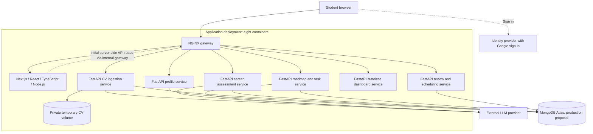

# Coachify architecture

Use the focused design references below for the next CV, JD/skills-analysis and
roadmap work. The repository also retains the broader six-service scaffold for
future expansion. P01–P16 are implemented in the frontend/profile slice; Career
now supports adaptive optional-CV exploration and explicit goal saving through one
shared chat page (including saved J02–J04 role/skill/condition reviews), alongside temporary
URL/document previews and CV read APIs. Dedicated CV extraction, broader skill mapping, research,
gap analysis and roadmap generation remain planned.

## Working design references

| File | Purpose |
|---|---|
| [MongoDB collections](diagrams/mongodb_collections_uml.mmd) | Supplied skills-service model: users, cvs, career_goals, interview_research and skill_gap_analyses, with ID references. |
| [Embedded objects](diagrams/mongodb_embedded_objects_uml.mmd) | Supplied CvSkill, TargetSkill, InterviewSkill, ResearchSource and GapResult structures embedded in those collections. |
| [Dockerised CV/JD/roadmap architecture](diagrams/dockerised-mvp.puml) | Scoped MongoDB design for CV ingestion, JD/career/skills analysis and roadmap services, with existing frontend/gateway/Profile dependencies. Expand as more services are designed. |

The Mermaid sources follow the supplied design, with collection naming and
identity/version/provenance details aligned to the implemented contracts. Open `.mmd` files in a Mermaid
preview and `.puml` files in a PlantUML preview. These are design references;
implementation status and detailed API contracts remain in the owning service.
The skills-service model spans CV and Career responsibilities in the current
checkout: map collection ownership through Jira contract task SCRUM-310 and the
[service boundaries](service-boundaries.md), rather than creating duplicate user
or profile authorities. `users` refers to the existing account authority;
`[FK]` denotes an application-validated ID reference. Private file retention and
optional/version/provenance details must be reconciled with the current contracts.

The supplied PlantUML source was an older six-service PostgreSQL diagram. Its
[unchanged original](diagrams/reference/dockerised-mvp.puml) is retained for
traceability. The active sibling diagram uses MongoDB and the requested three
core services. It does not remove the existing Profile/auth implementation or
require future dashboard/review services to be built now.

## Broader service scaffold — future context

The overview below preserves the wider six-service plan. It is not the focused
three-service implementation scope and supersedes the PostgreSQL assumptions in
earlier `outputs/` documents.

## Boundaries

- Next.js supplies pages, shared layouts, rendering, and interactive React components. It does not directly write domain records in MongoDB.
- Browser API calls use the gateway's `/api/v1` routes. Server-side Next.js reads may use an internal gateway URL.
- Each backend service owns its data and deploys independently. The dashboard aggregates through APIs and has no independent database.
- Five logical databases may share an Atlas deployment with service-scoped credentials. Local development can use one additional MongoDB container.
- Background execution initially belongs inside the responsible service container, backed by durable operation records. It is not implemented.
- The original CV is staged in a private host-backed Docker volume. Extracted and clarified information persists in MongoDB. Successful processing triggers eventual original-file deletion and cleanup.
- Task completion and reopening trigger automatic dashboard refetches. Scheduled reviews analyse pace separately and generate candidate revisions; a current approval policy controls application.
- Replanning preserves completed work and student edits. It does not silently change target jobs, deadlines, or availability.
- No additional AI microservice, message broker, or vector database is part of the first scaffold.

## Authentication status

The profile slice supports verified email/password accounts and optional Google. New accounts complete an emailed OTP step before obtaining a revocable 24-hour Coachify session. Development uses a private Mailpit inbox; production uses authenticated encrypted SMTP. Canonical profile completion controls initial onboarding and workspace access. Session bearers live in tab-scoped sessionStorage and are validated before private data loads. Sign-out/account changes clear other tabs. Set the matching Google Web Client ID on both sides for Google mode. See the [application setup guide](../setup.md) for setup and remaining integration limits.

See [service boundaries](service-boundaries.md), [API planning](../api/README.md), and [MongoDB guidance](../../infrastructure/mongodb/README.md).

## Career preview slice — J01/J06/J07

Career Goal has three temporary input methods; no LLM or Career database is used.
Career validates sessions via the Profile API and returns URL/document previews.
Original uploads use private tmpfs and are closed/deleted after processing. Source
text exists only in request/process/browser memory, with no persistence. Future
structured skill review now uses explicit AI extraction/chat requests, separately
from import previews. J02–J04 now persist structured reviews and confirmed goal requirements, with a
small explicit alias registry and pending status for unknown skill identities.
Interview research and gap analysis remain planned. Full source
persistence stays intentionally excluded.
