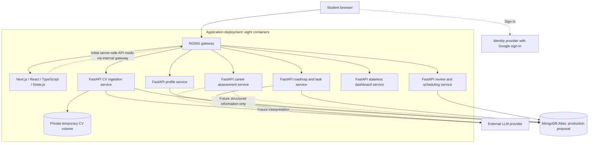

# Current Coachify architecture

This is the current design: Next.js App Router + React + TypeScript frontend, NGINX gateway, six Python FastAPI services, and MongoDB. It supersedes PostgreSQL/frontend-runtime assumptions in the earlier `outputs/` documents. P01–P16 are implemented in the frontend/profile slice. Career currently prepares temporary URL/document previews; interpretation and the remaining services are planned.

## Boundaries

- Next.js supplies pages, shared layouts, rendering, and interactive React components. It does not directly write domain records in MongoDB.
- Browser API calls use the gateway's `/api/v1` routes. Server-side Next.js reads may use an internal gateway URL.
- Each backend service owns its data and deploys independently. The dashboard aggregates through APIs and has no independent database.
- Five logical databases may share an Atlas deployment with service-scoped credentials. Local development can use one additional MongoDB container.
- Background execution initially belongs inside the responsible service container, backed by durable operation records. It is not implemented.
- The original CV is staged in a private host-backed Docker volume. Extracted and clarified information persists in MongoDB. Successful processing triggers eventual original-file deletion and cleanup.
- Task completion and reopening trigger automatic dashboard refetches. Scheduled reviews analyse pace separately and generate candidate revisions; a current approval policy controls application.
- Replanning preserves completed work and student edits. It does not silently change target jobs, deadlines, or availability.
- No additional AI microservice, message broker, or vector database is part of the first scaffold.

## Authentication status

The profile slice supports verified email/password accounts and optional Google. New accounts complete an emailed OTP step before obtaining a revocable 24-hour Coachify session. Development uses a private Mailpit inbox; production uses authenticated encrypted SMTP. Canonical profile completion controls initial onboarding and workspace access. Session bearers live in tab-scoped sessionStorage and are validated before private data loads. Sign-out/account changes clear other tabs. Set the matching Google Web Client ID on both sides for Google mode. See the [application setup guide](../setup.md) for setup and remaining integration limits.

See [service boundaries](service-boundaries.md), [API planning](../api/README.md), and [MongoDB guidance](../../infrastructure/mongodb/README.md).

## Career preview slice — J01/J06/J07

Career Goal has three temporary input methods; no LLM or Career database is used.
Career validates sessions via the Profile API and returns URL/document previews.
Original uploads use private tmpfs and are closed/deleted after processing. Source
text exists only in request/process/browser memory, with no persistence. Future
structured extraction/storage awaits its agreed schema. This intentionally defers
earlier saved-source/interpretation criteria.
