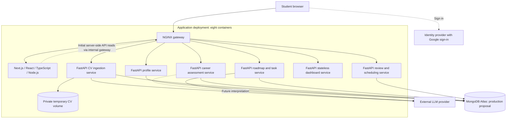

# Coachify architecture

Use the focused design references below for CV, JD/skills-analysis and roadmap
work. The repository also retains the broader six-service scaffold for future
expansion. P01–P16 and account-level manual declarations are available in Profile.
CV supplies saved upload/review, corrections, explicit selection, interpreted
target-relevant clarifications and versioned capability inputs. Raw answers remain
separate from validated source-linked claims; replacement review and manual
attachment repair require explicit choices. Career provides temporary URL/document
previews, reviewed target skills and qualification/date conditions, and explicit
confirmation/selection. The target-bound CV handoff captures the selected source
and target revisions for a future consumer to revalidate. AI target generation,
research, assessment admission, gap analysis, result staleness and roadmap
generation remain planned. CV extraction and answer interpretation require an
explicitly configured provider; synthetic tests do not establish production model
quality.

## Working design references

| File | Purpose |
|---|---|
| [MongoDB collections](diagrams/mongodb_collections_uml.mmd) | Five logical collections with existing account identity, CV ownership and planned Career references; operational records shown separately. |
| [Embedded objects](diagrams/mongodb_embedded_objects_uml.mmd) | Supplied CvSkill, TargetSkill, InterviewSkill, ResearchSource and GapResult structures embedded in those collections. |
| [Dockerised CV/JD/roadmap architecture](diagrams/dockerised-mvp.puml) | Scoped MongoDB design for CV ingestion, JD/career/skills analysis and roadmap services, with existing frontend/gateway/Profile dependencies. Expand as more services are designed. |

The Mermaid sources reconcile the supplied model with C-facing ownership. Open
`.mmd` files in a Mermaid preview and `.puml` files in a PlantUML preview. Detailed
schemas and implementation status remain in the owning service contracts.
The skills-service model spans CV and Career responsibilities in the current
checkout: map collection ownership through Jira contract task SCRUM-310 and the
[service boundaries](service-boundaries.md), rather than creating duplicate user
or profile authorities. `users` refers to the existing account authority;
`[FK]` denotes an application-validated ID reference. Private file retention and
optional/version/provenance details must be reconciled with the current contracts.

The supplied PlantUML source was an older six-service PostgreSQL diagram. Its
[unchanged original](diagrams/reference/dockerised-mvp.puml) is retained for
traceability. The active sibling diagram uses MongoDB and the requested three
core services. It does not remove the existing Profile/auth implementation or
require future dashboard/review services to be built now.

## Broader service scaffold — future context

The overview below preserves the wider six-service plan. It is not the focused
three-service implementation scope and supersedes the PostgreSQL assumptions in
earlier `outputs/` documents.

## Boundaries

- Next.js supplies pages, shared layouts, rendering, and interactive React components. It does not directly write domain records in MongoDB.
- Browser API calls use the gateway's `/api/v1` routes. Server-side Next.js reads may use an internal gateway URL.
- Each backend service owns its data and deploys independently. The dashboard aggregates through APIs and has no independent database.
- Five logical databases may share an Atlas deployment with service-scoped credentials. Local development can use one additional MongoDB container.
- CV background execution belongs inside its service container, backed by durable operations and bounded leases; no separate broker is needed.
- The original CV is staged in a private Docker volume with bounded retention and cleanup. Only structured facts and bounded evidence persist as domain data. A purged original requires explicit re-upload for reprocessing; no public permanent file URL is provided.
- Task completion and reopening trigger automatic dashboard refetches. Scheduled reviews analyse pace separately and generate candidate revisions; a current approval policy controls application.
- Replanning preserves completed work and student edits. It does not silently change target jobs, deadlines, or availability.
- No additional AI microservice, message broker, or vector database is part of the first scaffold.

## Authentication status

The profile slice supports verified email/password accounts and optional Google. New accounts complete an emailed OTP step before obtaining a revocable 24-hour Coachify session. Development uses a private Mailpit inbox; production uses authenticated encrypted SMTP. Canonical profile completion controls initial onboarding and workspace access. Session bearers live in tab-scoped sessionStorage and are validated before private data loads. Sign-out/account changes clear other tabs. Set the matching Google Web Client ID on both sides for Google mode. See the [application setup guide](../setup.md) for setup and remaining integration limits.

See [service boundaries](service-boundaries.md), [API planning](../api/README.md), and [MongoDB guidance](../../infrastructure/mongodb/README.md).

## Career preview slice — J01/J06/J07

Career Goal has three temporary input methods. The preview requests use no LLM
and do not persist source text. Reviewed targets use a separate Career-owned database.
Career validates sessions via the Profile API and returns URL/document previews.
Original uploads use private tmpfs and are closed/deleted after processing. Source
text exists only in request/process/browser memory. Reviewed role/field/skills and
bounded evidence persist in immutable `career_goals` snapshots; explicit confirmation
and versioned selection supply CV context. Career makes no AI calls.

## Saved CV and manual declarations — C01–C09

CV owns each upload, review item, source-specific correction and clarification;
Profile owns declarations embedded in the existing account. CV composes their
independent versions through authenticated APIs. Selection is explicit and stored
separately from upload status. Same-name evidence requires an attach/distinct
choice and never becomes extra proof merely through repetition. See
[service boundaries](service-boundaries.md#c-facing-ownership-and-compatibility),
[CV rules](../../services/cv-service/SPEC.md) and
[Profile declaration rules](../../services/profile-service/SPECIFICATION.md#manual-capabilities--c07).

Material clarification uses the owner’s current confirmed Career context through
its API. No selected target defers preparation; a dependency outage offers retry.
Preparation records exact target/selection/extraction versions and rechecks current
selection. Pending questions follow relevance; answers and skips remain source facts
across target switches. A reviewed target or completed clarification does not imply
a generated gap analysis or job readiness.
