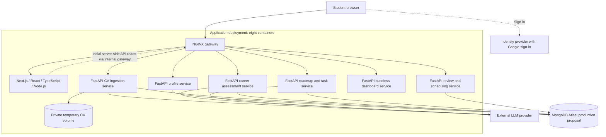

# Coachify architecture

The implemented slice combines Profile/account access, saved conversational CV review and Career's canonical goal/research workspace. The broader six-service scaffold remains future context. CV owns factual evidence, correction overlays, source-linked clarification and private resumable messages. Profile owns manual declarations. Career owns one current goal and public-context research; an explicit acknowledgement of its exact goal/version/selection makes it usable for CV clarification.

Career JD/discovery/research uses configured Gemini/Brave adapters. CV extraction, conversation routing and clarification interpretation use its separate configurable OpenAI-compatible provider. Model output is validated before factual publication. Synthetic checks establish workflow and contract behavior, not live-model quality. Assessment computation, broad registry mapping, gap analysis and roadmaps remain planned.

## Working design references

| File | Purpose |
|---|---|
| [MongoDB collections](diagrams/mongodb_collections_uml.mmd) | Supplied skills-service model: users, cvs, career_goals, interview_research and skill_gap_analyses, with ID references. |
| [Embedded objects](diagrams/mongodb_embedded_objects_uml.mmd) | Supplied CvSkill, TargetSkill, InterviewSkill, ResearchSource and GapResult structures embedded in those collections. |
| [Dockerised CV/JD/roadmap architecture](diagrams/dockerised-mvp.puml) | Scoped MongoDB design for CV ingestion, JD/career/skills analysis and roadmap services, with existing frontend/gateway/Profile dependencies. Expand as more services are designed. |

The Mermaid sources follow the supplied design, with collection naming and
identity/version/provenance details aligned to the implemented contracts. Open `.mmd` files in a Mermaid
preview and `.puml` files in a PlantUML preview. These are design references;
implementation status and detailed API contracts remain in the owning service.
The skills-service model spans CV and Career responsibilities in the current
checkout: map collection ownership through Jira contract task SCRUM-310 and the
[service boundaries](service-boundaries.md), rather than creating duplicate user
or profile authorities. `users` refers to the existing account authority;
`[FK]` denotes an application-validated ID reference. Private file retention and
optional/version/provenance details must be reconciled with the current contracts.

The supplied PlantUML source was an older six-service PostgreSQL diagram. Its
[unchanged original](diagrams/reference/dockerised-mvp.puml) is retained for
traceability. The active sibling diagram uses MongoDB and the requested three
core services. It does not remove the existing Profile/auth implementation or
require future dashboard/review services to be built now.

## Broader service scaffold — future context

The overview below preserves the wider six-service plan. It is not the focused
three-service implementation scope and supersedes the PostgreSQL assumptions in
earlier `outputs/` documents.

## Boundaries

- Next.js supplies pages, shared layouts, rendering, and interactive React components. It does not directly write domain records in MongoDB.
- Browser API calls use the gateway's `/api/v1` routes. Server-side Next.js reads may use an internal gateway URL.
- Each backend service owns its data and deploys independently. The dashboard aggregates through APIs and has no independent database.
- Five logical databases may share an Atlas deployment with service-scoped credentials. Local development can use one additional MongoDB container.
- CV processing/conversation tasks and Career workflows execute inside their owning services with durable operation state, bounded work and recovery fencing. No separate worker microservice is introduced.
- The original CV is staged in a private host-backed Docker volume. Extracted and clarified information persists in MongoDB. Successful processing triggers eventual original-file deletion and cleanup.
- Future task completion/reopening will trigger dashboard refetches; scheduled reviews and authorised revision application remain planned.
- Planned replanning must preserve completed work and student edits without silently changing goals, deadlines or availability.
- No additional AI microservice, message broker, or vector database is part of the first scaffold.

## Authentication status

The profile slice supports verified email/password accounts and optional Google. New accounts complete an emailed OTP step before obtaining a revocable 24-hour Coachify session. Development uses a private Mailpit inbox; production uses authenticated encrypted SMTP. Canonical profile completion controls initial onboarding and workspace access. Session bearers live in tab-scoped sessionStorage and are validated before private data loads. Sign-out/account changes clear other tabs. Set the matching Google Web Client ID on both sides for Google mode. See the [application setup guide](../setup.md) for setup and remaining integration limits.

See [service boundaries](service-boundaries.md), [API planning](../api/README.md), and [MongoDB guidance](../../infrastructure/mongodb/README.md).

## Career input, goal and research

Preview parsing validates URLs/documents without model calls or persisted raw sources. Explicit extraction and conversational discovery save structured canonical goals through the same Career persistence path. One live workspace per account uses owner/version checks; Career's automatic saves can start cited public research without silently confirming that goal for CV clarification. Temporary checkpoints expire independently of persistent goals and research.

The `career_state.cv_confirmation` stamp stores the exact goal ID/version, selection version, projection hash and acknowledgement time. Bounded confirmation receipts support exact retries. Context reads revalidate the stamp against the current canonical goal and selection, including a goal edit that advances its version before selection changes. Confirmation does not create another goal record or advance selection merely to record acknowledgement. Earlier UUID reviewed targets remain historical records; canonical reads filter their shape instead of treating them as current ObjectId goals.

Career reads saved CVs through the CV API and preserves their original UUIDs, source attribution and uncertainty. Its internal projection also accepts earlier ObjectId CV references. The 512 KiB Career intake limit is independent of CV's larger record limit; oversized data is rejected clearly without truncation. A source-identity mapping version is not treated as equivalent to Career's dotted skill registry, so future analysis remains responsible for explicit mapping.

## Saved CV and manual declarations — C01–C09

CV owns each upload, review item, source-specific correction and clarification;
Profile owns declarations embedded in the existing account. CV composes their
independent versions through authenticated APIs. Selection is explicit and stored
separately from upload status. Same-name evidence requires an attach/distinct
choice and never becomes extra proof merely through repetition. See
[service boundaries](service-boundaries.md#c-facing-ownership-and-compatibility),
[CV rules](../../services/cv-service/SPEC.md) and
[Profile declaration rules](../../services/profile-service/SPECIFICATION.md#manual-capabilities--c07).

Material clarification uses the owner’s current confirmed Career context through
its API. No confirmed current goal defers preparation; a dependency outage offers retry.
Preparation records exact target/selection/extraction versions and rechecks current
selection. Pending questions follow relevance; answers and skips remain source facts
across target switches. A confirmed goal or completed clarification does not imply
a generated gap analysis or job readiness.

The conversational screen uses a CV-owned operational history with independent
revisions and action receipts. It can resume without a CV for manual declarations,
handle side questions without evidence changes, and show explicit correction/addition
choices. Messages and source-bound interpretations remain distinct. The server
retains paginated history in bounded segments without automatic expiry; a new
continuation links back to its full segment. See
[conversation boundaries](service-boundaries.md#conversational-cv-review).
