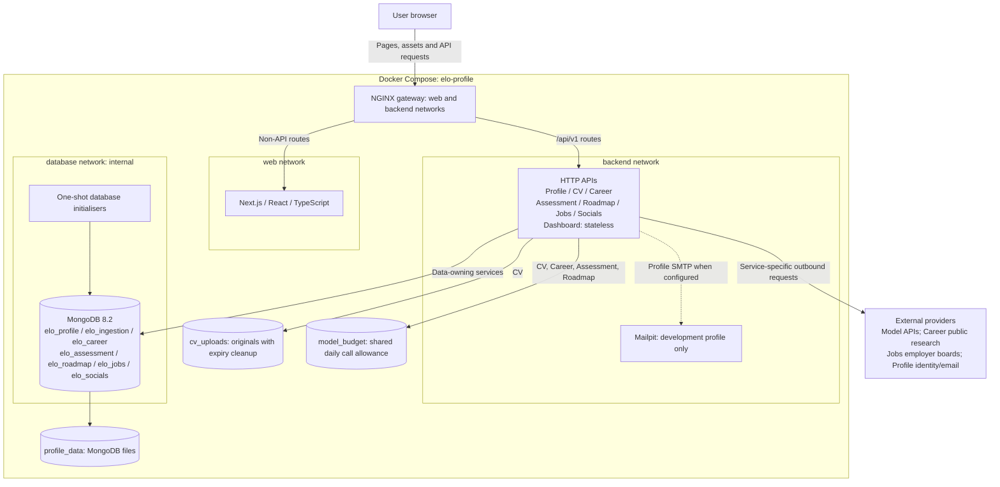

# elo architecture

The current Compose stack runs Next.js behind NGINX with Profile, CV, Career, Assessment, Roadmap, Jobs, Socials and Dashboard. Each service owns a separate MongoDB database except the stateless Dashboard API. Review remains a scaffold.

Profile owns accounts, background and manual declarations. CV owns saved evidence, source corrections, resumable extraction and private conversations. Career owns the canonical goal, its explicit CV confirmation stamp and public research. Assessment owns immutable versioned comparisons; Roadmap owns plans, sessions and progress. Jobs searches employer boards live and stores self-reported application snapshots. Synthetic checks establish workflow and contract behavior, not live-model quality.

## Architecture diagrams

| File | Purpose |
|---|---|
| [Deployment and data ownership](diagrams/dockerised-mvp.puml) | Current Compose services, networks, gateway routes, databases, volumes and external providers. |
| [Service API dependencies](diagrams/service-api-dependencies.mmd) | Caller → callee HTTP dependencies, including conditional Jobs recommendation reads and confirmed Roadmap evidence writes. |
| [MongoDB collections](diagrams/mongodb_collections_uml.mmd) | Selected domain and operational collections, ownership, references and version metadata. |
| [Embedded objects](diagrams/mongodb_embedded_objects_uml.mmd) | Evidence, research, assessment and planning structures, including nested Roadmap planner state. |

Open `.mmd` files in a Mermaid preview and `.puml` files in a PlantUML preview. These diagrams describe source structure; detailed schemas and implementation limits remain in the service specifications and [API contracts](../../contracts/api/). Collection UML uses `users` as the logical Profile authority, physically stored in `accounts`. The two workspace aliases refer to separate physical `workspaces` collections in `elo_assessment` and `elo_roadmap`; `[FK]` denotes an application-validated reference, not a MongoDB foreign key.

The [original PostgreSQL diagram](diagrams/reference/dockerised-mvp.puml) is retained unchanged for historical reference. It does not describe the current deployment.

## Deployment overview

The [detailed deployment diagram](diagrams/dockerised-mvp.puml) expands the API group into individual services and database owners. Model calls use the OpenAI Python SDK with OpenRouter defaults and service-specific overrides. Career public research defaults to OpenRouter native web search, with Brave LLM Context as fallback.

Review is not part of this deployment. The gateway blocks `/internal/` and unknown `/api/` paths. Profile database bootstrap runs through MongoDB's `init-profile.js` mount; the other databases use the one-shot initialisers.

The home dashboard reads Career, CV, Assessment, Roadmap and Jobs through the gateway's domain API routes. It does not use the separate Dashboard aggregation API. Jobs generates search links for Prosple, Huzzle, LinkedIn and Indeed for the browser to open; the server does not fetch those sites or submit applications.

See the [API dependency diagram](diagrams/service-api-dependencies.mmd) and [service boundaries](service-boundaries.md) for HTTP calls. Roadmap currently calls Assessment and Profile, obtaining CV/Career context through Assessment. Jobs additionally calls Career and CV for `sort=recommended`. Compose still injects unused CV/Career URLs into Roadmap and only a Profile URL into Jobs; Jobs uses the shared client's default internal Career/CV hostnames. These diagrams follow the current calls, not unused configuration.

## Boundaries

- Next.js supplies pages, shared layouts, rendering, and interactive React components. It does not directly write domain records in MongoDB.
- Browser API calls use the gateway's `/api/v1` routes. The frontend joins the web network; backend services communicate over HTTP on the backend network.
- Each backend service owns its data and deploys independently. The dashboard aggregates through APIs and has no independent database.
- Compose runs one MongoDB container on the internal database network, with a separate database and credentials for each data-owning service. MongoDB Atlas remains a production proposal.
- CV processing/conversation tasks and Career workflows execute inside their owning services with durable operation state, bounded work and recovery fencing. No separate worker microservice is introduced.
- CV originals use the private `cv_uploads` named volume. The ingestion worker removes expired originals (24-hour default retention) and releases their byte reservations. The latest extraction graph state, including parsed text, is persisted separately in `cv_extraction_states`; saved evidence and history remain in MongoDB.
- The home dashboard can mark Roadmap tasks complete and refresh its saved views. Scheduled progress reviews remain unimplemented.
- Planned replanning must preserve completed work and student edits without silently changing goals, deadlines or availability.
- Model calls and workers run inside the owning services. No separate AI microservice, message broker or vector database is deployed. CV, Career, Assessment and Roadmap share the `model_budget` volume for the daily call allowance.

## Authentication status

The profile slice supports verified email/password accounts and optional Google. New accounts complete an emailed OTP step before obtaining a revocable 24-hour elo session. Development uses a private Mailpit inbox; production uses authenticated encrypted SMTP. Canonical profile completion controls initial onboarding and workspace access. Browser credentials live in a Profile-issued HttpOnly cookie; a matching tab marker and browser header let NGINX forward the owner bearer to services for validation. Sign-out/account changes clear other tabs. Set the matching Google Web Client ID on both sides for Google mode. See the [application setup guide](../setup.md) for setup and remaining integration limits.

See [service boundaries](service-boundaries.md), [API planning](../api/README.md), and [MongoDB guidance](../../infrastructure/mongodb/README.md).

## Career input, goal and research

Preview parsing validates URLs/documents without model calls or persisted raw sources. Explicit extraction and conversational discovery save structured canonical goals through the same Career persistence path. One live workspace per account uses owner/version checks; Career's automatic saves can start cited public research without silently confirming that goal for CV clarification. Temporary checkpoints expire independently of persistent goals and research.

The `career_state.cv_confirmation` stamp stores the exact goal ID/version, selection version, projection hash and acknowledgement time. Bounded confirmation receipts support exact retries. Context reads revalidate the stamp against the current canonical goal and selection, including a goal edit that advances its version before selection changes. Confirmation does not create another goal record or advance selection merely to record acknowledgement. Earlier UUID reviewed targets remain historical records; canonical reads filter their shape instead of treating them as current ObjectId goals.

Career reads saved CVs through the CV API and preserves their original UUIDs, source attribution and uncertainty. Its internal projection also accepts earlier ObjectId CV references. The 512 KiB Career intake limit is independent of CV's larger record limit; oversized data is rejected clearly without truncation. A source-identity mapping version is not treated as equivalent to Career's dotted skill registry, so future analysis remains responsible for explicit mapping.

## Saved CV and manual declarations — C01–C09

CV owns each upload, review item, source-specific correction and clarification;
Profile owns declarations embedded in the existing account. CV composes their
independent versions through authenticated APIs. Selection is explicit and stored
separately from upload status. Same-name evidence requires an attach/distinct
choice and never becomes extra proof merely through repetition. See
[service boundaries](service-boundaries.md#c-facing-ownership-and-compatibility),
[CV rules](../../services/cv-service/SPEC.md) and
[Profile declaration rules](../../services/profile-service/SPECIFICATION.md#manual-capabilities--c07).

Material clarification uses the owner’s current confirmed Career context through
its API. No confirmed current goal defers preparation; a dependency outage offers retry.
Preparation records exact target/selection/extraction versions and rechecks current
selection. Pending questions follow relevance; answers and skips remain source facts
across target switches. A confirmed goal or completed clarification does not imply
a generated gap analysis or job readiness.

The conversational screen uses a CV-owned operational history with independent
revisions and action receipts. It can resume without a CV for manual declarations,
handle side questions without evidence changes, and show explicit correction/addition
choices. Messages and source-bound interpretations remain distinct. The server
retains paginated history in bounded segments without automatic expiry; a new
continuation links back to its full segment. See
[conversation boundaries](service-boundaries.md#conversational-cv-review).

Assessment and Roadmap use separate databases and service-scoped model credentials; the adviser UI and its versioned source comparison share `/roadmap`.
