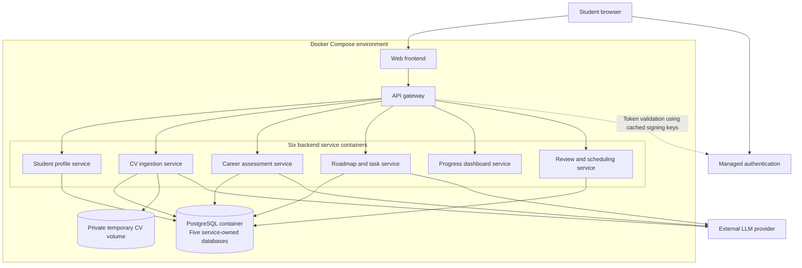
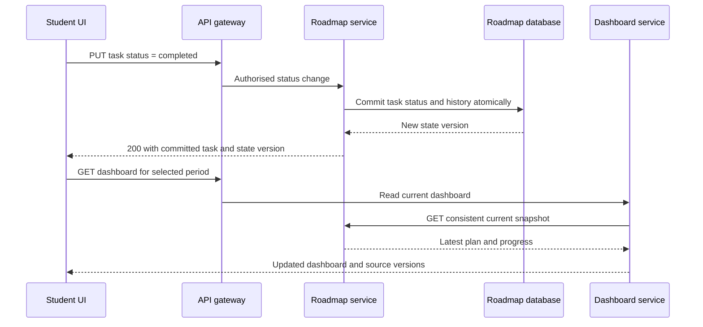

# elo — MVP microservice architecture and API catalogue

Proposed design based on the agreed user stories, including personal-contribution clarification, student-edited roadmaps, persistent dashboards, and scheduled adaptation. This is a design specification; these APIs have not been implemented.

## Deployment shape

Run six backend domain services, one web frontend, one API gateway, and one PostgreSQL instance as nine Docker Compose containers. Use managed authentication and an external LLM provider. Each domain service owns its data and exposes APIs; it never reads another service's database directly.

The dashboard is a stateless aggregation service in this iteration. The other five domain services each have a separate logical database and separate credentials within the shared PostgreSQL instance. A private volume belongs only to CV ingestion for temporary uploads. No message broker, vector database, or separate AI microservice is required for this iteration.



This topology diagram shows deployment, routing, and storage. Service-to-service calls are listed separately below to keep the diagram readable. Only the web entry point and gateway are published to the host. Backend container ports and PostgreSQL remain private. Services that call the LLM need outbound network access. Compose provides discovery by service name: https://docs.docker.com/compose/how-tos/networking/.

## Service boundaries and story coverage

| Container | Responsibility | Story coverage | Data owned |
|---|---|---|---|
| `web` | Forms, clarification conversation, roadmap editing, task actions, and dashboard period selection | All student-facing flows | Browser UI state only |
| `gateway` | Routing, token validation, request limits, rate limits, and correlation IDs | Supporting infrastructure | No business records |
| `profile-service` | Canonical education, work experience, personal contributions, capabilities, and profile versions | P01–P03; C02/C06/C07 after ingestion | Profile database |
| `cv-service` | File validation, text extraction, provisional profile, ambiguity detection, targeted clarification, and reviewed-profile import | C01–C08 | Ingestion database and temporary files |
| `career-service` | Job description interpretation, capability comparison, gap prioritisation, and reassessment | J01–J05; G01–G07 | Career database |
| `roadmap-service` | Planning constraints, generation, milestones, tasks, progress history, revisions, and application of revisions | P04–P06; R01–R09; E01–E07; T01–T06; A02–A04 | Roadmap database |
| `dashboard-service` | Aggregate current task and milestone progress, requirement status, and latest pace analysis | D01–D06 | None; reads through domain APIs |
| `review-service` | Manual reviews, review schedules, pace analysis, adjustment requests, and approval policy | A01 orchestration; S01–S06 | Review database |

Ten epics do not require ten independently deployed services. For example, roadmap generation, editing, and task tracking share the same task model and transactional ownership.

Planning constraints belong to a roadmap rather than a global student profile. This keeps deadlines, weekly hours, and availability exceptions attached to the goal they describe.

## API conventions

- Browser APIs below have the common prefix `/api/v1` and are exposed through the gateway.
- `/internal/v1` APIs are private service-to-service routes and are never forwarded by the public gateway.
- Students authenticate through the managed identity provider. elo does not implement its own password or token issuance endpoints in this design.
- All services enforce resource ownership. Internal services use scoped service identities and explicit owner context; they do not trust an arbitrary browser-supplied student ID.
- Standard writes return 200/201 or 204. Slow extraction, assessment, and generation return 202 with an operation ID and status URL.
- Browser calls never contain the LLM provider secret. The CV, career, and roadmap services use the provider through a shared client library, not a separate AI service.
- Query parameters shown are illustrative contracts. Full request and response schemas remain a subsequent implementation deliverable.

## 1. Student profile service APIs

The profile is the canonical description of the student's capabilities. CV extraction remains provisional until the ingestion flow is completed. Correcting extracted details before completion happens in the CV service; subsequent profile edits happen here.

| Method | Endpoint | Purpose |
|---|---|---|
| GET | `/profile` | Read the student's current profile and version. |
| PATCH | `/profile` | Update university, degree programme, or study year. |
| POST | `/profile/items` | Add education, experience, a project, or a declared capability; `kind` identifies the item type. |
| PATCH | `/profile/items/{itemId}` | Correct an item, personal contribution, or capability description. |
| DELETE | `/profile/items/{itemId}` | Remove an incorrectly attributed profile item. |
| POST | `/internal/v1/profile/imports` | Idempotently import reviewed CV data using an ingestion ID; return a new profile version. |
| GET | `/internal/v1/profile/versions/{versionId}` | Fetch an immutable profile version for assessment or planning. |

All profile writes create a new version. Existing assessments preserve their original snapshot. Responses expose the current profile version so the UI can indicate when assessment or planning needs updating.

## 2. CV ingestion service APIs

| Method | Endpoint | Purpose |
|---|---|---|
| POST | `/cv/ingestions` | Upload a text-based PDF or DOCX using multipart form data; start extraction and ambiguity detection. |
| GET | `/cv/ingestions/{ingestionId}` | Read processing status and the provisional extracted profile. |
| PATCH | `/cv/ingestions/{ingestionId}/items/{itemId}` | Correct an extracted item before it enters the canonical profile. |
| POST | `/cv/ingestions/{ingestionId}/items` | Add an omitted item during ingestion. |
| DELETE | `/cv/ingestions/{ingestionId}/items/{itemId}` | Remove an incorrectly extracted item. |
| GET | `/cv/ingestions/{ingestionId}/clarifications` | Read unresolved targeted questions about projects, responsibilities, or other ambiguities. |
| PUT | `/cv/ingestions/{ingestionId}/clarifications/{questionId}/response` | Answer or explicitly skip a question; update the provisional interpretation. |
| POST | `/cv/ingestions/{ingestionId}/complete` | Finish ingestion and import the reviewed profile into the profile service. |

`complete` means “continue with this profile”; it is not an additional activity-by-activity confirmation. Unresolved questions may be explicitly skipped. A contribution explanation is sufficient and takes precedence over broad CV wording. No proof upload is required. Do not ask another question if the prior answer already resolved it.

Example response payload for a project question:

```json
{
  "status": "answered",
  "answer": "I cleaned the dataset and built charts with guidance. My teammates trained and deployed the model."
}
```

Use `{"status":"skipped"}` when the student does not answer. The affected capability remains uncertain. Delete temporary original CV files after successful extraction according to an explicit retention policy; retain the extracted information needed to resume ingestion.

## 3. Career assessment service APIs

| Method | Endpoint | Purpose |
|---|---|---|
| POST | `/career/targets` | Save a pasted job description and start requirement extraction. |
| GET | `/career/targets/{targetId}` | Read role title, skills, non-skill conditions, and essential/preferred classifications. |
| PATCH | `/career/targets/{targetId}` | Correct the identified role or requirements; version the target. |
| POST | `/career/assessments` | Assess a specified profile version against a specified target version. |
| GET | `/career/assessments/{assessmentId}` | Read strengths, partial matches, uncertainty, prioritised gaps, and constraints. |
| POST | `/career/assessments/{assessmentId}/clarifications` | Accept a student correction and reassess affected capabilities, without requiring evidence. |
| GET | `/internal/v1/career/assessments/{assessmentId}/versions/{versionId}` | Fetch an immutable assessment for roadmap generation or review. |

Assessment corrections that describe a personal capability also update the canonical profile through the profile API, using the same correction request ID to avoid duplicates. The resulting assessment refers to the resulting profile version. If a downstream operation fails, persist its state and retry rather than silently losing the correction.

Suggested requirement status: `supported`, `partial`, `uncertain`, or `gap`. Include requirement references, a reason, and the student information used. Completing tasks does not automatically promote a requirement to `supported`.

## 4. Roadmap and task service APIs

This service is the sole owner of tasks and task status. The dashboard and review services never write task records directly.

| Method | Endpoint | Purpose |
|---|---|---|
| POST | `/roadmaps` | Create a draft goal with target, assessment reference, application date, weekly hours, and timezone. |
| GET | `/roadmaps?state=active` | Restore the student's active roadmap; the MVP supports one active target at a time. |
| GET | `/roadmaps/{roadmapId}` | Read the current plan, constraints, milestones, and source versions. |
| PATCH | `/roadmaps/{roadmapId}/constraints` | Update application deadline, weekly capacity, or timezone and mark the plan for review. |
| POST | `/roadmaps/{roadmapId}/availability-exceptions` | Add a period of reduced availability. |
| PATCH | `/roadmaps/{roadmapId}/availability-exceptions/{exceptionId}` | Update an existing availability exception. |
| DELETE | `/roadmaps/{roadmapId}/availability-exceptions/{exceptionId}` | Remove an availability exception. |
| POST | `/roadmaps/{roadmapId}/generations` | Generate the initial plan from pinned assessment and constraint versions. |
| GET | `/roadmaps/{roadmapId}/tasks?view=week&anchorDate=2026-10-18&actionable=true` | Read tasks in daily, weekly, or monthly form; optionally show only actionable work. |
| POST | `/roadmaps/{roadmapId}/tasks` | Add a student-authored task with action, outcome, effort, timing, and optional requirement links. |
| PATCH | `/roadmaps/{roadmapId}/tasks/{taskId}` | Edit instructions, completion outcome, effort, timing, dependencies, or requirement links. |
| DELETE | `/roadmaps/{roadmapId}/tasks/{taskId}` | Remove a task from active planning and report resulting conflicts. |
| PUT | `/roadmaps/{roadmapId}/tasks/{taskId}/status` | Set `todo`, `in_progress`, or `completed`; record status history and completion dates. |
| GET | `/roadmaps/{roadmapId}/revisions` | List candidate and historical revisions, including automatically applied revisions. |
| GET | `/roadmaps/{roadmapId}/revisions/{revisionId}` | Read a proposed or historical change set and its explanations. |
| POST | `/roadmaps/{roadmapId}/revisions/{revisionId}/apply` | Apply a reviewed candidate if its source versions are still current. |
| POST | `/roadmaps/{roadmapId}/revisions/{revisionId}/dismiss` | Dismiss a pending proposal without changing the active plan. |
| GET | `/internal/v1/roadmaps/{roadmapId}/snapshot` | Read a consistent snapshot of plan, task states, status history, constraints, and versions. |
| POST | `/internal/v1/roadmaps/{roadmapId}/revisions` | Accept a review service request to generate a candidate revision; do not overwrite the active plan. |
| POST | `/internal/v1/roadmaps/{roadmapId}/revisions/{revisionId}/apply` | Apply a candidate under a current, explicitly enabled automatic-review policy. |

An initial generation activates a valid first plan. A revision always starts as a candidate. A non-fit result may report infeasibility instead of activating an unrealistic schedule. Never automatically change the target job, declared availability, or application deadline.

The revision model preserves stable task IDs, completed work, student overrides, and removal markers. Removed tasks must not silently return after generation. Use a monotonically increasing roadmap state version covering constraints, edits, and task progress. Applying a revision validates its base state and relevant profile/assessment versions; stale proposals return 409 and require a new review.

Example task status payload:

```json
{
  "status": "completed",
  "expectedStateVersion": 12
}
```

Return the committed task and new `stateVersion`. A repeated identical status request must not create duplicate completion events.

## 5. Progress dashboard service API

| Method | Endpoint | Purpose |
|---|---|---|
| GET | `/dashboard?roadmapId={id}&period=week&anchorDate=2026-10-18` | Return goals, completed/remaining work, milestones, requirement development status, next tasks, and available pace analysis. |

`period` accepts `day`, `week`, `month`, or `all`. Use the roadmap's stored IANA timezone to compute period boundaries. A user can navigate previous or future periods using `anchorDate`. Before a plan exists, return an onboarding/empty state.

There is no dashboard-generation endpoint. This service reads current domain data on request. It has no independent task-progress store to become stale. Return source versions and timestamps; identify missing data and outdated pace analysis explicitly.

Dashboard task progress is deterministic and does not require an LLM. For example, show completed task count separately from completed estimated effort, and never label either as a guaranteed probability of getting the job.

### Automatic dashboard refresh



The frontend immediately updates the completed task and invalidates/refetches dashboard and milestone data after success. The refresh path must not depend on LLM availability. Reopening and editing tasks use the same refresh mechanism. For other open browser tabs, use periodic refetch and refetch-on-focus for the MVP; instantaneous multi-session push would require an additional SSE/WebSocket design.

## 6. Review and scheduling service APIs

| Method | Endpoint | Purpose |
|---|---|---|
| POST | `/reviews` | Request a manual pace review for a roadmap and, where warranted, a proposed adjustment. |
| GET | `/reviews?roadmapId={id}` | List the roadmap's reviews. |
| GET | `/reviews/{reviewId}` | Read review status, pace analysis, findings, source versions, and any candidate revision reference. |
| GET | `/review-schedules/{roadmapId}` | Read frequency, timezone, approval mode, enabled state, and next review time. |
| PUT | `/review-schedules/{roadmapId}` | Save review frequency and approval mode, or pause/resume scheduled reviews. |
| GET | `/internal/v1/reviews/latest?roadmapId={id}` | Read the latest completed pace analysis for dashboard aggregation. |
| GET | `/internal/v1/review-schedules/{roadmapId}` | Let the roadmap service verify the current automatic-application policy. |

Schedule payload example:

```json
{
  "enabled": true,
  "frequency": "weekly",
  "localTime": "20:00",
  "dayOfWeek": "SUN",
  "timeZone": "Asia/Singapore",
  "approvalMode": "manual"
}
```

Support daily, weekly, and monthly schedules; monthly schedules use `dayOfMonth` instead of `dayOfWeek`. Validate frequency-specific fields and define an explicit last-day fallback for months that lack the selected day. Store next execution timestamps in UTC while retaining the IANA timezone and local schedule.

### Review execution

1. The scheduler claims a due schedule from its own database with a lease and a unique execution ID.
2. It fetches current profile, assessment, and roadmap snapshots through their APIs.
3. It compares planned work with recorded completion history. Missing updates alone do not establish inactivity.
4. It saves a dated review. If history is insufficient, record that limit rather than asserting a reliable forecast.
5. If adjustment is meaningful, request a candidate from the roadmap service.
6. For manual approval, leave the candidate pending. For automatic approval, the roadmap service rechecks the live schedule policy and candidate source versions before applying it.
7. Record the outcome and compute the next execution time. An ordinary task completion refreshes the dashboard independently of these scheduled runs.

The scheduler is a background runner inside the review-service container for the first iteration. It calls internal application functions for claiming schedules; there is no public “run all due reviews” API. A later deployment can split the runner into its own container without changing the student-facing APIs.

## Service-to-service dependency map

| Caller | Callee | Reason |
|---|---|---|
| CV | Profile | Import the clarified profile idempotently. |
| Career | Profile | Fetch profile versions; persist new capability declarations. |
| Roadmap | Profile, Career | Obtain source versions for generation and freshness checks. |
| Roadmap | Review | Verify current automatic-application policy before applying a scheduled revision. |
| Dashboard | Roadmap, Career, Review | Aggregate current tasks, capability assessment, and available pace analysis. |
| Review | Profile, Career, Roadmap | Capture review inputs, request candidates, and request authorised application. |

The roadmap service's policy check is a read-only call; it must not synchronously trigger another review, preventing a request loop. The review database stores candidate IDs while the candidate bodies remain owned by the roadmap service.

## Shared operational endpoints and reliability

Every service exposes private `GET /health/live` and `GET /health/ready`. Readiness reflects required local infrastructure; a provider outage should not disable unrelated task tracking or dashboard functionality.

CV, career, roadmap, and review services expose the following browser routes using their own prefix, for example `/api/v1/cv/operations/{operationId}`:

| Method | Relative endpoint | Purpose |
|---|---|---|
| GET | `/{servicePrefix}/operations/{operationId}` | Inspect `queued`, `running`, `succeeded`, or `failed` state and result reference. |
| POST | `/{servicePrefix}/operations/{operationId}/retry` | Retry a recoverable failed operation without re-uploading saved inputs. |

`servicePrefix` is `cv`, `career`, `roadmaps`, or `reviews`. Only the owning student or an authorised service can read or retry an operation. Persist input references, results, and job leases in the owning service's database; a request-handler process must not be the only place an in-flight operation exists. Initial workers can run in their service container; split worker replicas later if needed.

Use idempotency keys for creates/generation/retry and scheduled execution IDs for review deduplication. CV import is idempotent by ingestion ID. Retrying or restarting must not create duplicate roadmaps or apply a revision twice.

Use optimistic concurrency for profile edits, task edits, and revision application. Validate LLM responses against schemas before saving them; separately validate task effort, prerequisite order, capacity, and preservation of student edits. Return clear validation errors and actionable retry states.

There is no distributed database transaction across services. Persist cross-service workflow state, use idempotent commands, and retry incomplete steps. Dashboard aggregation returns source versions; if an upstream service is unavailable, label the affected panel unavailable rather than inventing a zero or claiming the student has no progress.

## First-iteration infrastructure choices

- Docker Compose with a private service network and persistent PostgreSQL volume.
- Five service-owned logical databases in one PostgreSQL container; separate credentials and migrations.
- Managed authentication; token and ownership checks on every relevant service boundary.
- Shared LLM client library for schema validation, timeouts, provider calls, and redacted logging.
- HTTP between services and polling of durable operation status for slow jobs.
- Immediate dashboard refetch after progress changes; scheduled review runner for deeper analysis.
- Temporary CV file volume rather than an additional object-storage container. Add private object storage if original uploads must be retained or CV workers scale across hosts.
- No message broker or cache in the first iteration. Add an event broker/outbox and a projected dashboard only if load or real-time multi-session requirements justify the additional components.

Source for Compose networking and service-name discovery: [Docker documentation](https://docs.docker.com/compose/how-tos/networking/). The service boundaries, APIs, and workflow choices above are proposed specifically for elo.

The accompanying JPG is rendered from `elo-architecture.uml` with PlantUML’s Smetana layout and converted to JPEG. It remains a historical PostgreSQL design; see `docs/architecture/` for the current implementation.
