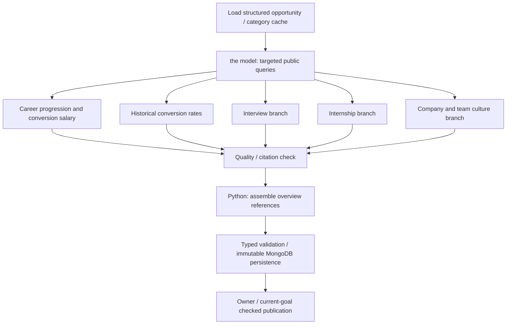

# Opportunity Intelligence

Current provider configuration: all model stages use the configured HTTPS
OpenAI-compatible Career model (OpenRouter by default). Retrieval uses Brave LLM
Context, the only search provider. Earlier model/Brave names below describe the
original path. Missing employer metadata stays unknown. See
[model/search setup](../../docs/setup.md#career-model-and-search-configuration).

Career expands saved goal requirements with five independently researched categories:
Interview Intelligence, Internship Insights, Career Progression, Historical Conversion
Rates and Company and Team Culture. The saved goal
and its skill/condition cards are immediately visible; public research appears below
in expandable sections. Refinement and safe replacement retain the existing guided
chat and automatic-save/version checks. CV upload and personal gap analysis remain
outside this feature.

## Graph and models

Research first runs one search per group of related topics, then targeted searches for topics
still not backed; see [Grouped research](#grouped-research--22-november-2026). Every requested
group's search runs before the category branches; each branch structures its topics' pages
through the configured model and searches again only for topics not yet backed. Branches
return separate category values at fan-in. No-company targets still research all five areas using general role queries; findings
are marked general context with low confidence, never employer-specific claims.
Employment type is extracted into saved JD metadata only when established; otherwise
it remains `unknown`. Related employment/location/role reports remain qualified.

All stages use the existing HTTPS OpenAI-compatible adapter with the server-only
`CAREER_LLM_API_KEY` and requested the configured `OPENROUTER_MODEL` identifier. Planning, structuring,
summaries, discovery and chat share the same enabled the model client. `AI_ENABLED`
is the master switch; `OPPORTUNITY_ENABLED` (true by default) enables public research.
Every stage uses the same configured Career model; see [setup](../../docs/setup.md#career-model-and-search-configuration).
The Brave client always uses LLM Context with the existing key.
Every research workflow uses this endpoint; legacy modes are ignored.
Opportunity requests consider 30 results with up to 12 passages per page and Brave's lenient
relevance cut-off, so useful text that does not repeat the query words is kept. The URL count per
search follows the topic's policy. A round whose structured output still fails validation after its
corrections is recorded and research moves on to the next round; the category fails only when no
round produced a validated finding. Candidate evidence remains checkpointed; each topic keeps its
own best sources (see below), and new pages lead the next evaluation, including after
quota/restart recovery.
Repeated URLs preserve saved excerpt text before appending new text within the excerpt limit.
Relevant sources with absent facts are distinguished from irrelevant search results.
Other research workflows retain their existing six-URL request limit.
Requests use 8,192 total context tokens, 2,048 per URL,
30 snippets total and six per URL. They use English, balanced context, operators on
without fallback, spellcheck off, local results off and source metadata on.
No SDK or other dependency was added. No environment files are read or edited.

There is no local token-per-minute admission limit. model/Brave provider quotas still apply. Exact evidence passages fit
within the configured model evidence budget (8,192 tokens by default, configurable
256–32,768), with a 24,000-character evidence guard for the existing request contract. Larger passages are shortened rather than discarded wholesale.
Context/output limits, timeouts, provider retry delays and bounded repairs remain.

## Evidence and presentation

`OpportunityReport` contains public opportunity identity/fingerprint, employment
metadata, five `CategoryResult` values, timestamps/status/warnings and a `Summary`.
Every `Finding` has a field, a concise evidence-grounded presentation value, confidence, evidence type,
source IDs, aligned exact quotes, context scope, optional conflict group and a
verification timestamp. All refs resolve to actual normalized source records. Source
metadata retains URL/title/platform, available publication dates and retrieval time.
`FIELD_GUIDANCE` maps each existing category's JSON field names to explicit meanings.
It is supplied with `allowed_fields` for every structuring request: salary/stipend →
`compensation`, conversion reports → `conversion_rate`, actual questions →
`interview_questions`, and so on. The structuring model returns final readable finding values and numbered evidence
passage references. Its request-specific schema restricts field names to the current
category and references to supplied sources/passages. Python copies each exact
passage and its source binding, then validates scope and support before constructing
`Finding` / `CategoryResult` / `OpportunityReport` models. Missing evidence
stays in `missing_fields`; source metadata alone never fills a finding.

Unknown metadata stays unknown. Source content is bounded at retrieval, then pooled
up to 8,000 characters per URL across categories; no full webpages are stored.

Python assembles overview references from retained finding IDs. The frontend resolves
these to their saved values for overview, takeaways, considerations and the completed
research chat. Both research tabs display saved finding values directly, with bold terms,
source-ID citations, context, uncertainty and partial results. Interview preparation displays
`interview_intelligence` fields and reported round labels. About the role displays findings
from the other four categories, plus the saved goal's extracted requirements and duties.
Neither tab requests `/v2/role-research`, `/v2/interview-research`, `/role-summary` or
`/interview-prep`; no model call condenses the findings for display, and there are no display-summary
word limits, style retries or truncation. The only presentation model pass shortens round titles
that exceed three words, as described below. Existing saved reports need
no migration or regeneration. The brief-generation APIs remain available but unused by the web app.
No later model call judges or rewrites finding wording for these tabs. Conflicting salary
reports remain separate and are never averaged. High confidence/official labels
are constrained by authoritative source metadata; related full-time reports do not
become exact internship evidence. These are source-backed reports, not guarantees
that the source is correct or independent.

## Storage, freshness and recovery

Reuse `career_goals` for the existing specific-job/general-target records; no duplicate
users, targets or opportunities collection is created. Specific public opportunities
use a stable fingerprint; general targets use a null opportunity ID. One current
selector remains, with in-place, version-checked current-goal edits. Multiple active target
selection and application tracking are outside this MVP.

Reuse `interview_research` for immutable public research, extended by optional
`intelligence`. New reports store no duplicate interview process/skills projection. Server-side Q&A
derives its temporary projection from validated category findings without another model call. Material fingerprints cover
company/role/location/seniority/employment type, job URL, relevant skills and hashed
structured requirement changes. Raw JD/CV/chat and private interests/preferences
never enter public research. Private `career_target_id` links are API projections,
not copied into a shared report.

Existing operational `research_contexts` stores private job/command receipts and
public cache leases. Private jobs contain owner/current-goal/version/run refs,
per-category results, query history and bounded acquired evidence. A partial unique
index prevents duplicate active jobs for the same owner/goal/run; commands retain
idempotency receipts, and a different payload cannot reuse the same key.

A recovery poller claims durable due jobs with expiring worker leases. Each category
is saved independently before/after model work. Existing MongoDB LangGraph checkpoint
collections retain safe state for 24 hours. The durable job can reconstruct its
unfinished branches even after checkpoint expiry or process restart; a completed
search is reused after provider quota pauses. Fresh categories are preserved during
individual refresh. A failed refresh retains previously validated findings. Stale
workers/replaced goals cannot change the latest workspace. Cache leases coordinate
identical public contexts across users; private goal access remains owner-scoped.

Each successful evidence evaluation commits its findings, next query and completion
cursor together. A quota pause resumes the unfinished evaluation without repeating
earlier successful the model calls. Invalid-response counts and safe correction feedback
also survive pauses, so a quota wait cannot reset the bounded repair budget.

Fresh categories last seven days by default; incomplete/missing/failed coverage has
one-hour expiry. Cache reuse itself has no paid call. Research status is explicit:
`pending`, `running`, `partial`, `completed`, `failed`; category status additionally
supports `not_applicable`. A successful empty search is completed with missing fields;
a technical failure is failed/partial, never a fabricated empty success.

Terminal progress distinguishes completed, partial and failed runs. `finished=true`
means the run stopped, including when all categories failed. Chat automatically
requests a digest for every finished report. Failed reports use a local, formatted
explanation of each category error and any retained findings rather than another
provider call; Resume research remains available. Completed/partial reports use the
goal-summary model with inline citations, section headings and bold topic labels.

The workspace preserves category errors such as `rate_limited` or
`source_rate_limited` while waiting, with the actual retry delay; it does not label
these waits `research_unavailable`. Global failures distinguish `research_timeout`,
`research_validation_failed` and `research_state_changed` and finish the workspace
loading state. Content-free logs include stage/category, error code, fixed validation
reason and quota scope, never source/model content or provider error bodies.

## APIs

All routes require the existing verified session/completed onboarding and no-store.

- `GET /api/v1/career/goals/{goal_id}/opportunity-research` — Current job/category
  status, available findings, source metadata and summary. Reading resumes due durable
  work. Optional `research_id` reads an exact owner-linked immutable version.
  `available` indicates configured capability, not verified provider billing/access.
  `availability_issues` contains only fixed codes: `research_disabled`,
  `reasoning_disabled`, `model_not_configured`, `brave_not_configured`, or
  `brave_llm_context_required`. The interface names the unavailable capability
  rather than claiming all credentials are missing; no configuration values leak.
- `POST /api/v1/career/goals/{goal_id}/opportunity-research` — Start/reuse or refresh;
  returns 202 and the same typed view. Requires UUID `Idempotency-Key`,
  `expected_version`, `expected_selection_version`, optional `refresh` (false) and
  optional `category` (`interview_intelligence`, `internship_insights`,
  `company_intelligence`). Null category covers all stale categories; `refresh=true`
  refreshes all, or only the specified category. Concurrent incompatible category
  refresh requests receive a recoverable conflict rather than being lost.

The new pipeline starts automatically from the validated-goal graph when configured.
Otherwise the workspace runs its interview research, and the intelligence interface
explains that its additional providers are needed. No silent provider substitution.

## Configuration and limits

Only Career receives these optional settings through Compose. Apply configuration
and recreate the service yourself; no credentials go into the frontend.

| Setting | Default | Meaning |
|---|---:|---|
| `OPPORTUNITY_ENABLED` | true | Enable when primary, the model and LLM Context are available |
| `OPPORTUNITY_TOPIC_SEARCHES` | 2 | Maximum gap searches per topic after the grouped search (1–4); each runs only while the topic is not yet backed |
| `OPPORTUNITY_RUN_SEARCHES` | 8 | Maximum searches per research run (1–200), including grouped and early JD searches; 8 is the 7 group searches plus 1 gap search |
| `OPPORTUNITY_CONCURRENCY` | 3 | Concurrent Brave requests across branches |
| `OPPORTUNITY_TIMEOUT_SECONDS` | 30 | Total deadline for each Brave attempt |
| `OPPORTUNITY_RETRIES` | 1 | Bounded transient retries with exponential backoff / 429 delay |
| `OPPORTUNITY_SCHEMA_REPAIRS` | 1 | Additional model attempts for schema/citation failure |
| `OPPORTUNITY_EVIDENCE_TOKENS` | blank | Exact passages per reasoning call (at least 256 when set); blank sends every retrieved passage whole |
| `OPPORTUNITY_FRESHNESS_HOURS` | 168 | Complete category freshness |
| `OPPORTUNITY_INCOMPLETE_HOURS` | 1 | Missing/error coverage freshness |
| `OPPORTUNITY_RUN_SECONDS` | 300 | Execution deadline per durable worker attempt |
| `OPPORTUNITY_TOKEN_BUDGET` | 230000 | Model tokens per research run (100,000–5,000,000), including searches made while the JD is read. Each search books 15,000 tokens before it runs and settles to its reported usage. Searches stop 60,000 tokens below the budget; no model call starts once it is spent, and categories stopped early end `partial` with error code `token_budget` |

Also requires enabled `AI_*`, the separate `CAREER_LLM_API_KEY`, `CAREER_RESEARCH_API_KEY`
with LLM Context access, and Career MongoDB configuration. Obsolete `GEMINI_*` settings
are ignored; `AI_ENABLED` controls all model operations. Legacy Search/Answers
mode likewise does not disable the dedicated LLM Context client. All stages request the configured application model constant; model-not-found/auth
failures are surfaced without guessed fallbacks.
Content-free logs and durable metrics track model attempts/provider numeric tokens,
search counts and node/category latency. Estimated cost is null because no validated
billing-price feed is configured. Provider quotas remain independently enforced.

## Verification

Run Career's `python -m pytest` independently with synthetic providers. Set
`MONGODB_TEST_URI` to disposable MongoDB for real cache, graph, idempotency, ownership,
partial-failure, expiry and restart tests. Frontend component/browser checks exercise
five sections, source/confidence labels, progress, the interview round overview and
separately padded round cards. Both research tabs expose no generation/refresh action and
make no research writes when loaded or reloaded. The optional
`OPPORTUNITY_LIVE_TEST=1` provider smoke test consumes real configured API requests;
it is skipped in normal runs and must never use private applicant data.

## Code map and rollout

| Area | Main files |
|---|---|
| Typed report/API models | `app/schemas/opportunity.py`, `opportunity_api.py`, additive fields in `analysis.py` / `jd.py` / `goals.py` |
| Provider contracts/config | `app/ai/opportunity_contracts.py`, `opportunity_config.py`, shared adapter/router/metrics |
| Graph, cache/jobs, evidence | `app/workflows/opportunity/engine.py`, `store.py`, `domain.py`, `sources.py` |
| API/startup/automatic handoff | `app/api/v1/opportunity.py`, `workspace.py`, `app/main.py`, `app/workflows/career.py` |
| Selector UI | `apps/frontend/src/features/career/opportunity-intelligence.tsx`, `career-overview.tsx`, `job-review-chat.tsx`, shared API types/styles |
| Verification | `tests/test_opportunity.py`, guided edit regression, frontend `opportunity-intelligence.test.tsx`, `career-overview.spec.ts` |
| Contracts/config/architecture | `contracts/api/career.yaml`, JSON model schemas, Compose Career environment map, application diagrams |

Rebuild/restart Career and the frontend through your normal development/deployment
workflow after applying configuration. Existing data is read with additive defaults;
indexes initialize automatically. No migration, new package or extra credential is
required. Run `python -m pytest` from Career's service folder with optional disposable
MongoDB; run frontend `npm run typecheck`, `npm test` and the targeted Playwright
Career journeys through the repository commands. No live paid requests are part of
normal checks.

`tests/test_opportunity_startup.py` specifically covers research startup with
legacy chat switches, each legacy Brave mode, missing credentials, explicit
research disablement, and safe availability diagnostics.

An invalid claim is excluded without discarding independently valid cited findings;
a wholly invalid batch still receives only bounded repairs. Polling no longer restarts
the legacy graph after this durable worker takes ownership. Provider cooldown and
historical local-window states remain readable. Saved-goal APIs are available during research
waits/failures; initial chat presentation waits for every applicable category and summary. No provider `Retry-After`
value is shortened to pretend a provider quota has reset.

## Early JD retrieval

A transient, evidence-checked job identity may start one template query per applicable
category while the full JD is extracted. The normal goal is saved before these results
can be adopted or published. Identity mismatch discards early evidence. Matching seeds
populate existing job queries/history/evidence; the model plans the remaining queries and
continues normal evaluation, citation validation, caching and summary selection.
Successful initial retrieval counts toward each category's search bound. An empty first
result can use the next planned query. Provider retry times survive adoption, and source
errors cannot erase or prevent a validated goal save. Checkpointed job `activities` contain
only fixed public stage IDs; source/JD/model reasoning text is not progress telemetry.

The initial chat response joins the saved JD and completed research in one typed message.
`attach` derives workspace readiness from all categories, not interviews alone. Summary
quota pauses resume the unfinished summary without repeating paid retrieval/evaluation.
Transient top-level failures receive one automatic durable retry; permanent failures
remain visible as failed state with saved findings retained. Failed/partial cached
categories are retried instead of being mistaken for completed research on a new run.

## Five role-tailored research categories (report schema v2)

Every employer-specific JD plans all five categories through the configured model
model before any initial Brave retrieval: interview experiences/stages/actual questions,
internship experience, career progression/full-time conversion compensation, historical
full-time conversion rates, and company/team culture. The first searches overlap full
JD extraction after identity validation. Both initial queries and targeted follow-ups
use role/field/division/programme/location-specific phrasing; there is no hardcoded
software vocabulary or template-query fallback. A failed early planner defers to the
durable planner without blocking goal saving. Planned queries and paid early evidence
are reused rather than planning/searching twice. All calls remain Brave LLM Context.

New report categories are `career_progression` (`full_time_role`, `career_path`,
`conversion_salary`) and `conversion_outcomes` (`conversion_rate`, `historical_cohort`,
`offer_acceptance`). `company_intelligence` now focuses on `company_culture`,
`team_culture`, `management` and `work_life_balance`. Existing category identifiers,
claim provenance and shared goal persistence stay stable. Reports carry
`schema_version` 2; the stored-shape upgrade clears version 1 reports so the next
request researches again, and gives unfinished three-category jobs the missing
categories without deleting paid evidence. A failed overall summary is recorded as
`summary_unavailable` so the next run rebuilds it.

Conversion percentages, intake sizes and salaries may be rough figures reported by candidates,
forums or salary/review sites; they are labelled reported/approximate at low or medium confidence,
and vague wording ("most") never becomes a number. Retain historical intern cohort/year context when supplied. Offers, acceptance and joining
remain distinct. Salary evidence retains currency, pay period, year and base/bonus
context; related graduate pay is not labelled an actual conversion offer. No unsupported
figures or rates are computed. Missing evidence stays missing in every category.
No-company goals also research all five categories with general role queries; all
findings are labelled general context/low confidence, never company-specific figures. Full-time JDs still research all five
areas when an employer is known, with internship evidence labelled related employment.

Search limits are now per topic; see [Per-topic research](#per-topic-research--20-november-2026).
Three concurrent acquisitions, 30-second source requests and bounded retries still apply,
and provider quotas apply.

## Evidence and missing information — 28 October 2026

Missing fields are coverage hints, never mandatory success criteria. A category with no
supported findings and no provider/validation error completes successfully and says:
“Information pertaining to this category was not found in the retrieved sources.”
A failed acquisition or exhausted invalid-response repair still reports a failure; an
empty result must not hide a provider error. The UI no longer displays a required-field checklist.

Supporting quotes still match their source excerpts after whitespace-only normalization.
Finding values may paraphrase those excerpts. Every accepted
source ID is copied from the exact cited source record, never generated by the model.
Opportunity excerpts retain up to 8,000 characters per source, then fit fairly within
the existing evidence-token/input-character budgets. The structuring request supplies numbered exact passages once, with separate source metadata.
The model structures Brave excerpts directly into the final user-facing `value` for each
finding. There is no second semantic-grading call or optional rewritten-summary field.
The structuring prompt requires faithful meaning, relevance to the requested category,
clear related-role context and no facts beyond the supplied evidence. Python validates
schema, source references, exact quotes and numeric tokens before saving. Semantic
faithfulness is the structuring model's responsibility; Python does not independently
prove the meaning of a paraphrase.

For new provider findings every numeric token in the displayed value must appear
exactly in the selected passage. Legacy internal findings retain the full-cited-excerpt
check, which permits numbers outside a narrower quote. Numbers from uncited sources do not
count. Numeric formatting is not rewritten or calculated. The former literal-unit
checks and mandatory salary/cohort year/period requirements are removed: absent details
stay absent, while stated details must retain their meaning. Structured findings do not establish
truth beyond the retrieved evidence.

Wholly invalid batches receive bounded repair feedback containing claim paths and fixed
issue codes, for example `findings.0.evidence_ref: evidence_reference_not_found`,
`findings.0.field: field_not_allowed`, or `findings.0.value: unsupported_number`.
Legacy quote/ref validation also retains its original issue codes.
Generation and storage share the same allowed confidence/evidence/scope labels and
600-character value and quote bounds. Values use the full
storage allowance instead of the former 320-character generation limit. The prompt
states these limits; the model decoding includes the allowed labels. Storage validation
errors retain their claim path and issue code instead of becoming an empty provenance
error. Feedback contains no source text or private data. Independently valid claims survive a bad
citation elsewhere in the batch. The structuring call uses bounded schema/citation repairs and existing quota handling.
Overview/takeaway references are assembled locally from saved findings without another
model call. Chat renders all retained finding values verbatim with their source links.

See [canonical goal and compact reads](ANALYSIS_CONTRACTS.md#canonical-goal-and-compact-reads--28-october-2026)
for result/progress separation and lazy, owner-scoped evidence retrieval.

Repeated finding IDs are merged before comparing presentation wording, preserving the
first ID and its quote/source alignment as corroborating citations grow. The quality
step also normalizes durable category results before summary selection, so previously
checkpointed duplicates cannot prevent final report publication. Conflicting figures
remain separate; final report identity/reference validation remains enforced.

## Coverage outcomes and follow-ups

Category `status` still reports execution success/failure. Additive `outcome` explains
`findings_found`, `no_relevant_sources`, `information_not_found`, `validation_failed`
or `provider_failed`; old reports default to null. `source_ids` identifies the retained
sources (each topic's kept sources, or up to three relevant pages when nothing was found). The model
returns bounded `relevant_refs` separately from findings; references must match the
supplied source indexes. Validated findings independently establish useful citations.

Planning favours official programme pages for programme facts, firsthand accounts for
interview/intern experience and explicit cohort publications for conversion rates. A
model follow-up targets the most important missing topic; an empty first evaluation
can use the next planned query. There is no extra search after the configured budget,
and no full-page scraper or unbounded search loop. Candidate evidence and evaluation
cursors survive quota waits/restarts without repeating successful paid retrieval.
The new cache policy prevents old short-excerpt reports from satisfying new research;
immutable historical reports and owner/version checks remain intact.

The active reasoning stages are `opportunity_plan`, `opportunity_triage` and `opportunity_structure`. Completed
chat text comes from the stored finding values; there is no later model rewrite or
judging stage. Historical reports remain readable under their original wording.

### Planner output recovery

Planning allows up to 1,024 output tokens and category structuring up to 4,096 (lowered by
`AI_MAX_OUTPUT_TOKENS` when set), independently of the 60-second default model deadline.
The planner returns one short query string per search group, with no wrapper.
Local research supplies the schema in the prompt and native decoding format.
Python retains schema/provenance validation; no malformed or truncated response
becomes a successful report. Repairs distinguish incomplete JSON from schema
violations, and content-free logs include safe field paths and issue codes.

### Request-bound fields and evidence passages — 1 November 2026

`opportunity_structure` uses a provider-only `ReferencedFindings` contract. For each
request the JSON schema enumerates the current category’s allowed `field` values,
the actual source indexes for `relevant_refs`, and actual passage indexes for each
finding’s `evidence_ref`. The prompt includes the same schema in JSON Object mode.
Backend validation also checks these references when a provider ignores its grammar.

Python prepares numbered exact source passages of at most 600 characters, retaining
their source index. Each finding selects one passage; Python copies its text and
resolves its source ID. The model never generates citation quotes or source bindings.
Finding values may paraphrase that selected passage, but their numbers must occur
there, in any common format (8k = 8,000 = S$8,000; "three" = 3). The only derived number is a
monthly amount from an annual figure in the passage, and the annual figure must also be shown. Identical findings from different passages can merge their verified citations.
Invalid references/fields are excluded without discarding independently valid claims;
a wholly invalid batch receives the existing bounded repairs. Passage catalogues are
never silently shortened after numbering to fit a model request.

Persisted findings, compact public responses and lazy evidence endpoints keep their
existing shapes. Historical reports remain readable, and no data migration, new
configuration, provider fallback or additional model/retrieval call is introduced.

## Interview research by round — 10 November 2026

Interview research covers every round the sources describe; jobs differ, so the number of
rounds is whatever the evidence supports and is never padded to a typical count. Each
interview finding may carry `round_number` (1 = first round, in reported order) and a short
`round_name` copied from its passage; process-wide facts (total rounds, overall timeline,
difficulty) leave both null. The new `round_format` field describes what one round consists of.
A round is kept only when its selected passage names it (or states its number with
"round", "stage" or "interview"); an unsupported round is dropped and the finding is kept.
Other categories cannot carry rounds, and their decoding schema omits the fields. The same
fact in two rounds stays two findings. Prompt version `opportunity-structured-findings-v4`.
Interview preparation groups findings by the saved `round_number`, in reported order,
into an independently padded card headed by the reported round name. The reported-round
count and a linked round overview appear above the other interview sections. Cards keep
their reported order with space between them. Neither research tab exposes a start or
refresh action; both read the saved results. Each card shows its original expectations,
reported questions and preparation topics with their citations and uncertainty. Missing
round-specific expectations or preparation are labelled, without generating replacements.
Findings without round metadata remain in general sections rather than being assigned to
an inferred round. Saved reports without rounds remain valid and display as process-wide
facts until refreshed. The descriptions and preparation remain unchanged. Display titles follow the rule below.

## Source merging and the quality recheck — 11 November 2026

A page returned by a later search is merged after the text already saved for it, so a passage a
finding has cited keeps its place when the merged text is cut at the excerpt limit
(`merge_sources`). The final quality recheck compares each finding's quote with that
category's own saved sources only (`category_sources`), so a page also cited by another
category cannot have this category's quoted text merged away. The word-for-word quote and number
checks themselves are unchanged. Reports already saved with a `validation_failed` category keep
their surviving findings until research is refreshed.

## Grouped research — 22 November 2026

Research now starts with one search per group of related topics instead of one per topic, then
searches for individual topics only where the grouped pages did not back them. Topic read, stop and
keep rules from [Per-topic research](#per-topic-research--20-november-2026) are unchanged.

| Group | Topics |
|---|---|
| `interview_process` | `recruitment_stages`, `round_format`, `application_timeline`, `difficulty` |
| `interview_content` | `interview_questions`, `preparation_topics`, `candidate_experience` |
| `pay` | `compensation`, `benefits`, `conversion_salary` |
| `intern_experience` | `projects`, `mentorship`, `work_life_balance` |
| `conversion` | `full_time_role`, `conversion_rate`, `historical_cohort`, `offer_acceptance` |
| `career` | `career_path` |
| `culture` | `company_culture`, `team_culture`, `management` |

1. **Plan.** `opportunity_plan` writes one role-specific query per group (up to 1,024 output
   tokens). A plain employer + role query per group fills any gap. Gap searches use plain employer +
   role + topic wording: first the topic's own terms, then wording aimed at review sites and forums.
2. **Grouped search.** Each requested group searches once and returns up to 10 results, which become
   candidates for every topic in the group. JD prefetch runs the same grouped searches.
3. **Run-wide triage.** One `opportunity_triage` call (one per 60 pages) labels every new grouped
   result against all requested topics. A page flagged for a topic outside its group also becomes a
   candidate for that topic. Categories triage only pages this call did not cover, for example after
   unusable triage output. Targeted gap searches also reuse these run-wide page labels; concurrent
   categories serialize triage for the same run. Rejected pages retain an empty label list.
4. **First read.** Each category reads its topics' flagged pages, at most one search's page
   allowance per topic (2 factual, 4 review). This leaves room for gap searches.
5. **Read once.** A page is extracted by the first category to claim it in the run. That category's
   extraction covers every topic, and findings for other categories' topics are shared as before. A
   failed extraction releases its claims. Quota-paused extractions retain their claims until
   resumption so their inputs and validation-repair budget stay unchanged. Findings shared by
   multiple categories reach each category, and grounded interview rounds survive cross-category
   extraction.
6. **Gap searches.** Each later round runs one search per topic that is still not backed and still
   has reads left, up to `OPPORTUNITY_TOPIC_SEARCHES` (default 2). Within a category, factual topics
   with no finding reserve searches first, then other factual topics, then review topics. In the first
   gap round each category may use only its share of the searches left after the grouped pass, in
   proportion to its topics, using integer shares whose sum fits the remaining allowance. Later
   rounds protect other categories' unused first-round shares until those categories finish or release
   them. Failed grouped searches count against the allowance too. A run never
   exceeds `OPPORTUNITY_RUN_SEARCHES` (default 8).
7. **Usage.** Job metrics record prompt, completion, total, cached and reasoning tokens per model
   stage. Search calls are recorded under `research_search`, with a search count and, for OpenRouter
   web search, the search model's token usage. Adopted JD prefetch carries its planner and search
   usage into these job metrics.

Cached reports from per-topic research remain valid and are reused until they expire. Jobs still
running from before this change continue from their saved per-topic state and run any grouped
searches they lack.

## Per-topic research — 20 November 2026

Each researched field (Salary, Benefits, Mentorship, interview Stages, Questions and so on) is a
topic with its own search, read, stop and keep rules. A topic shared by two categories
(`work_life_balance`) is searched once by its first category and read by both.

| Topic kind | Topics | Pages read per search | Pages read per topic | Stops when | Sources kept |
|---|---|---:|---:|---|---:|
| Factual | `compensation`, `benefits`, `conversion_salary`, `conversion_rate`, `historical_cohort`, `offer_acceptance`, `full_time_role`, `application_timeline`, `recruitment_stages` | 2 | 5 | two different sites back its findings with no conflict | 2 |
| Reviews and sentiment | every other topic | 4 | 8 | four different sites back its findings | 4 |

1. **Plan.** The planner writes one or two queries per topic; plain employer + role + topic queries
   (the second aimed at salary/review sites and forums) fill any gap.
2. **Search.** Each search returns up to six results. Every requested topic's first search runs
   concurrently before the category branches (or during JD extraction).
3. **Triage.** For each category round, one `opportunity_triage` model call sees only each new
   result's URL, title, published date and a 300-character description, and names the still-needed
   topics each page likely answers. Pages it leaves out are never read. If triage output is unusable,
   each topic reads its own top-ranked results instead.
4. **Read.** Each topic reads its own search's triaged pages up to the per-search limit, then pages
   other topics' searches found for it, within its total. Only read pages go to
   `opportunity_structure`.
5. **Extract.** The structuring call lists the category's own fields first and every other topic
   after them, so a section of a page that answers an unplanned topic becomes a cited finding for
   that topic. Findings for another category's topics are handed to that category with only their
   cited passages and merged in the quality step under the same per-topic limits.
6. **Stop.** A backed topic, counting findings handed over from other categories, leaves the search
   list. Otherwise a topic searches again while it has searches (`OPPORTUNITY_TOPIC_SEARCHES`,
   default 2) and reads left. A run never exceeds `OPPORTUNITY_RUN_SEARCHES` (default 8); each
   search also counts toward the per-account daily allowance.
7. **Keep.** Each topic keeps its best sources up to its limit, preferring different sites, exact
   scope, higher confidence and the preferred evidence type. A finding keeps only its citations from
   kept sources. Kept sources store only the passages their findings cite; a category with no
   findings keeps up to three relevant pages with one short excerpt each.

Search providers return page text with each result, so a rejected page's text is downloaded but
never sent to the structuring model or saved in a report. Career does not fetch research pages
itself. A category may cite up to 40 pages and record up to 50 searches; a report holds up to 100
pages. The cache policy is `opportunity-intelligence-topic-findings-v7`, so earlier reports are not
reused for new research.

## Short interview round titles

`OpportunityView.round_titles` maps reported round numbers to display titles of 1–3 words.
The original `round_name`, description, evidence, quotes and source IDs remain unchanged in
immutable research. Short names pass through with no model or cache write. After research
finishes, only overlong names enter a single `interview_round_titles` batch; its input contains
public round names and numbers only. The provider schema and server checks enforce the word
limit and exact requested round identities. There are no semantic correction/rewrite retries.

The result is stored separately in existing `research_contexts` rows of kind `round_titles`,
keyed by the public names and format version. Atomic insertion claims one attempt across
concurrent readers and service processes; later reads reuse it, including for existing saved
reports and explicitly linked historical research. Authentication and goal ownership are
checked before title preparation. No new endpoint, configuration or collection is introduced.
The request is bounded to 20 seconds; concurrent readers wait at most the claim's 25-second
window. Failures, invalid titles and interrupted attempts use `Round N` without issuing another
pass for the same batch. A storage outage skips the model rather than making an uncached call.
Shortening tasks continue after a page request disconnects so another page can reuse the result.
