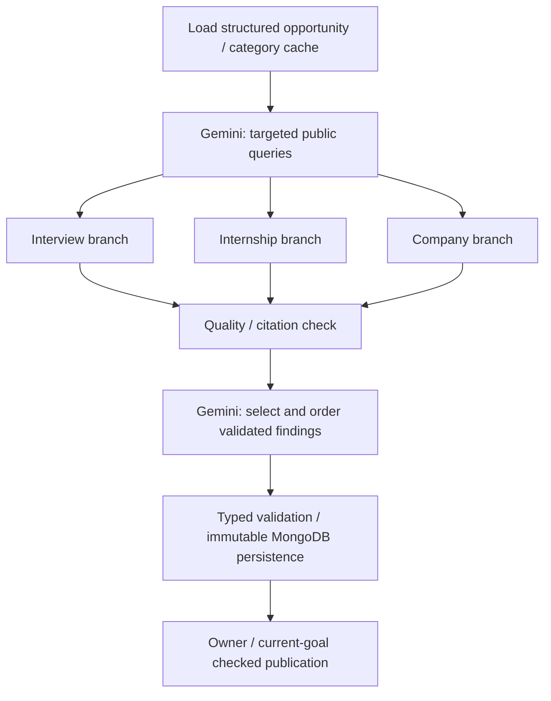

# Opportunity Intelligence

Career expands saved goal requirements with three independently researched categories:
Interview Intelligence, Internship Insights and Company Intelligence. The saved goal
and its skill/condition cards are immediately visible; public research appears below
in expandable sections. Refinement and safe replacement retain the existing guided
chat and automatic-save/version checks. CV upload and personal gap analysis remain
outside this feature.

## Graph and models

Each branch retrieves Brave LLM Context, saves the successful bounded retrieval,
evaluates it through the configured primary model, and can make a bounded targeted
follow-up. Branches return separate category values at fan-in. No-company targets
research general interviews and mark employer-specific categories not applicable.
Employment type is extracted into saved JD metadata only when established; otherwise
it remains `unknown`. Related employment/location/role reports remain qualified.

Use the existing HTTPS OpenAI-compatible HTTP adapter: `AI_*` controls the primary
reasoner (intended `openai/gpt-oss-120b` on Groq); `GEMINI_API_KEY` supplies the
separate Google credential/base configuration. `OPPORTUNITY_GEMINI_MODEL` defaults
to `gemini-3.5-flash` and changes only public research coordination, preserving the
existing chat context model. Both documented provider contracts support this
integration; credentials/account access are verified only by an opt-in live call.
Research is enabled by `OPPORTUNITY_ENABLED` (true by default), independently of
the optional `GEMINI_ENABLED` chat switch. Its Brave client always uses LLM Context
with the existing key, independently of the legacy `BRAVE_SEARCH_MODE` selection.
No SDK or other dependency was added. No environment files are read or edited.

The local 4,000-input and completed 7,000-token/user/rolling-minute rules remain
Groq-only. Evidence is selected as complete entries within the configured token
budget; oversized inputs are never silently sent. Model corrections are bounded
for this pipeline independently of the legacy chat recovery policy.

## Evidence and presentation

`OpportunityReport` contains public opportunity identity/fingerprint, employment
metadata, three `CategoryResult` values, timestamps/status/warnings and a `Summary`.
Every `Finding` has a field, a short extractive value, confidence, evidence type,
source IDs, aligned exact quotes, context scope, optional conflict group and a
verification timestamp. All refs resolve to actual normalized source records. Source
metadata retains URL/title/platform, available publication dates and retrieval time.
Unknown metadata stays unknown. Source content is bounded at retrieval, then pooled
up to 2,400 characters per URL across categories; no full webpages are stored.

Gemini's summary selects/ranks validated finding IDs. The frontend resolves these
to their original values for overview, takeaways and considerations. This MVP uses
extractive summaries rather than unconstrained paraphrases, preventing a final
summary from adding uncited facts. GPT may identify contradictions; multiple salary
reports remain separate and are never averaged. High confidence/official labels
are constrained by authoritative source metadata; related full-time reports do not
become exact internship evidence. These are source-backed reports, not guarantees
that the source is correct or independent.

## Storage, freshness and recovery

Reuse `career_goals` for the existing specific-job/general-target records; no duplicate
users, targets or opportunities collection is created. Specific public opportunities
use a stable fingerprint; general targets use a null opportunity ID. One current
selector remains, with immutable historical goal records. Multiple active target
selection and application tracking are outside this MVP.

Reuse `interview_research` for immutable public research, extended by optional
`intelligence`. Existing interview consumers receive a conservative sourced process/
preparation projection without another model call. Material fingerprints cover
company/role/location/seniority/employment type, job URL, relevant skills and hashed
structured requirement changes. Raw JD/CV/chat and private interests/preferences
never enter public research. Private `career_target_id` links are API projections,
not copied into a shared report.

Existing operational `research_contexts` stores private job/command receipts and
public cache leases. Private jobs contain owner/current-goal/version/run refs,
per-category results, query history and bounded acquired evidence. A partial unique
index prevents duplicate active jobs for the same owner/goal/run; commands retain
idempotency receipts, and a different payload cannot reuse the same key.

A recovery poller claims durable due jobs with expiring worker leases. Each category
is saved independently before/after model work. Existing MongoDB LangGraph checkpoint
collections retain safe state for 24 hours. The durable job can reconstruct its
unfinished branches even after checkpoint expiry or process restart; a completed
search is reused after provider quota pauses. Fresh categories are preserved during
individual refresh. A failed refresh retains previously validated findings. Stale
workers/replaced goals cannot change the latest workspace. Cache leases coordinate
identical public contexts across users; private goal access remains owner-scoped.

Each successful evidence evaluation commits its findings, next query and completion
cursor together. A quota pause resumes the unfinished evaluation without repeating
earlier successful Groq calls. Invalid-response counts and safe correction feedback
also survive pauses, so a quota wait cannot reset the bounded repair budget.

Fresh categories last seven days by default; incomplete/missing/failed coverage has
one-hour expiry. Cache reuse itself has no paid call. Research status is explicit:
`pending`, `running`, `partial`, `completed`, `failed`; category status additionally
supports `not_applicable`. A successful empty search is completed with missing fields;
a technical failure is failed/partial, never a fabricated empty success.

The workspace preserves category errors such as `rate_limited` or
`source_rate_limited` while waiting, with the actual retry delay; it does not label
these waits `research_unavailable`. Global failures distinguish `research_timeout`,
`research_validation_failed` and `research_state_changed` and finish the workspace
loading state. Content-free logs include stage/category, error code, fixed validation
reason and quota scope, never source/model content or provider error bodies.

## APIs

All routes require the existing verified session/completed onboarding and no-store.

- `GET /api/v1/career/goals/{goal_id}/opportunity-research` — Current job/category
  status, available findings, source metadata and summary. Reading resumes due durable
  work. Optional `research_id` reads an exact owner-linked immutable version.
  `available` indicates configured capability, not verified provider billing/access.
  `availability_issues` contains only fixed codes: `research_disabled`,
  `reasoning_disabled`, `gemini_not_configured`, `brave_not_configured`, or
  `brave_llm_context_required`. The interface names the unavailable capability
  rather than claiming all credentials are missing; no configuration values leak.
- `POST /api/v1/career/goals/{goal_id}/opportunity-research` — Start/reuse or refresh;
  returns 202 and the same typed view. Requires UUID `Idempotency-Key`,
  `expected_version`, `expected_selection_version`, optional `refresh` (false) and
  optional `category` (`interview_intelligence`, `internship_insights`,
  `company_intelligence`). Null category covers all stale categories; `refresh=true`
  refreshes all, or only the specified category. Concurrent incompatible category
  refresh requests receive a recoverable conflict rather than being lost.

The new pipeline starts automatically from the validated-goal graph when configured.
Otherwise legacy interview research remains available, and the intelligence interface
explains that its additional providers are needed. No silent provider substitution.

## Configuration and limits

Only Career receives these optional settings through Compose. Apply configuration
and recreate the service yourself; no credentials go into the frontend.

| Setting | Default | Meaning |
|---|---:|---|
| `OPPORTUNITY_ENABLED` | true | Enable when primary, Gemini and LLM Context are available |
| `OPPORTUNITY_GEMINI_MODEL` | gemini-3.5-flash | Coordination model; separate from chat |
| `OPPORTUNITY_MAX_SEARCHES` | 2 | Maximum distinct successful queries/category |
| `OPPORTUNITY_MAX_FOLLOWUPS` | 1 | Maximum targeted follow-ups/category |
| `OPPORTUNITY_CONCURRENCY` | 3 | Concurrent Brave requests across branches |
| `OPPORTUNITY_TIMEOUT_SECONDS` | 30 | Total deadline for each Brave attempt |
| `OPPORTUNITY_RETRIES` | 1 | Bounded transient retries with exponential backoff / 429 delay |
| `OPPORTUNITY_SCHEMA_REPAIRS` | 1 | Additional model attempts for schema/citation failure |
| `OPPORTUNITY_EVIDENCE_TOKENS` | 1000 | Complete evidence entries per reasoning call |
| `OPPORTUNITY_FRESHNESS_HOURS` | 168 | Complete category freshness |
| `OPPORTUNITY_INCOMPLETE_HOURS` | 1 | Missing/error coverage freshness |
| `OPPORTUNITY_RUN_SECONDS` | 300 | Execution deadline per durable worker attempt |

Also requires enabled `AI_*`, the separate `GEMINI_API_KEY`, `BRAVE_API_KEY`
with LLM Context access, and Career MongoDB configuration. `GEMINI_ENABLED=false`
can keep Gemini chat off without disabling public research. Legacy Search/Answers
mode likewise does not disable the dedicated LLM Context client. Model IDs remain
replaceable; model-not-found/auth failures are surfaced without guessed fallbacks.
Content-free logs and durable metrics track model attempts/provider numeric tokens,
search counts and node/category latency. Estimated cost is null because no validated
billing-price feed is configured. Provider quotas remain independently enforced.

## Verification

Run Career's `python -m pytest` independently with synthetic providers. Set
`MONGODB_TEST_URI` to disposable MongoDB for real cache, graph, idempotency, ownership,
partial-failure, expiry and restart tests. Frontend component/browser checks exercise
three sections, source/confidence labels, progress and targeted refresh. The optional
`OPPORTUNITY_LIVE_TEST=1` provider smoke test consumes real configured API requests;
it is skipped in normal runs and must never use private applicant data.

## Code map and rollout

| Area | Main files |
|---|---|
| Typed report/API models | `app/schemas/opportunity.py`, `opportunity_api.py`, additive fields in `analysis.py` / `jd.py` / `goals.py` |
| Provider contracts/config | `app/ai/opportunity_contracts.py`, `opportunity_config.py`, shared adapter/router/metrics |
| Graph, cache/jobs, evidence | `app/workflows/opportunity/engine.py`, `store.py`, `domain.py`, `sources.py` |
| API/startup/automatic handoff | `app/api/v1/opportunity.py`, `workspace.py`, `app/main.py`, `app/workflows/career.py` |
| Selector UI | `apps/frontend/src/features/career/opportunity-intelligence.tsx`, `career-overview.tsx`, `job-review-chat.tsx`, shared API types/styles |
| Verification | `tests/test_opportunity.py`, guided edit regression, frontend `opportunity-intelligence.test.tsx`, `career-overview.spec.ts` |
| Contracts/config/architecture | `contracts/api/career.yaml`, JSON model schemas, Compose Career environment map, application diagrams |

Rebuild/restart Career and the frontend through your normal development/deployment
workflow after applying configuration. Existing data is read with additive defaults;
indexes initialize automatically. No migration, new package or extra credential is
required. Run `python -m pytest` from Career's service folder with optional disposable
MongoDB; run frontend `npm run typecheck`, `npm test` and the targeted Playwright
Career journeys through the repository commands. No live paid requests are part of
normal checks.

`tests/test_opportunity_startup.py` specifically covers research startup with
Gemini chat disabled, each legacy Brave mode, missing credentials, explicit
research disablement, and safe availability diagnostics.
