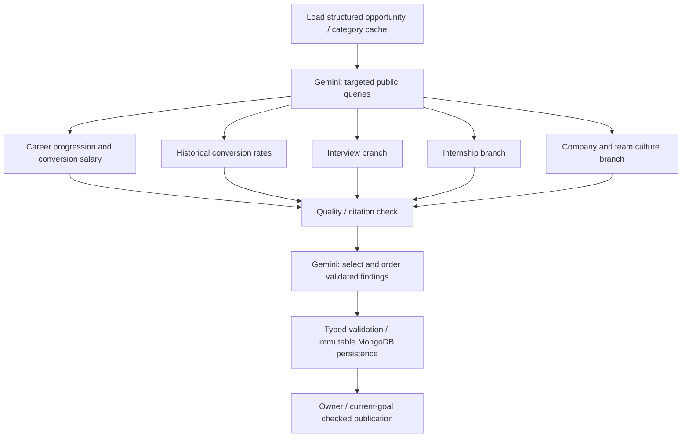

# Opportunity Intelligence

Career expands saved goal requirements with five independently researched categories:
Interview Intelligence, Internship Insights, Career Progression, Historical Conversion
Rates and Company and Team Culture. The saved goal
and its skill/condition cards are immediately visible; public research appears below
in expandable sections. Refinement and safe replacement retain the existing guided
chat and automatic-save/version checks. CV upload and personal gap analysis remain
outside this feature.

## Graph and models

Each branch retrieves Brave LLM Context, saves the successful bounded retrieval,
evaluates it through the configured primary model, and can make a bounded targeted
follow-up. Branches return separate category values at fan-in. No-company targets still research all five areas using general role queries; findings
are marked general context with low confidence, never employer-specific claims.
Employment type is extracted into saved JD metadata only when established; otherwise
it remains `unknown`. Related employment/location/role reports remain qualified.

All stages use the existing HTTPS OpenAI-compatible adapter with the server-only
`GEMINI_API_KEY` and requested `gemini-3.5-flash-lite` identifier. Planning, evaluation,
summaries, discovery and chat share the same enabled Gemini client. `AI_ENABLED`
is the master switch; `OPPORTUNITY_ENABLED` (true by default) enables public research.
Every stage uses the same configured Gemini model. The explicit Flash Lite model ID is used; see [setup](../../docs/setup.md#gemini-reasoning-configuration).
The Brave client always uses LLM Context with the existing key.
Every research workflow uses this endpoint; legacy modes are ignored.
Requests consider 30 results, with six URLs, 8,192 total context tokens, 2,048 per URL,
30 snippets total and six per URL. They use English, balanced context, operators on
without fallback, spellcheck off, local results off and source metadata on.
No SDK or other dependency was added. No environment files are read or edited.

There is no local token-per-minute admission limit. Gemini/Brave provider quotas still apply. Exact evidence passages fit
within the configured model evidence budget (8,192 tokens by default, configurable
256–32,768), with a 24,000-character evidence guard for the existing request contract. Larger passages are shortened rather than discarded wholesale.
Context/output limits, timeouts, provider retry delays and bounded repairs remain.

## Evidence and presentation

`OpportunityReport` contains public opportunity identity/fingerprint, employment
metadata, five `CategoryResult` values, timestamps/status/warnings and a `Summary`.
Every `Finding` has a field, a concise evidence-grounded presentation value, confidence, evidence type,
source IDs, aligned exact quotes, context scope, optional conflict group and a
verification timestamp. All refs resolve to actual normalized source records. Source
metadata retains URL/title/platform, available publication dates and retrieval time.
`FIELD_GUIDANCE` maps each existing category's JSON field names to explicit meanings.
It is supplied with `allowed_fields` for every evaluation: salary/stipend →
`compensation`, conversion reports → `return_offer`, actual questions →
`interview_questions`, and so on. The evaluator returns an exact evidence extract and an optional presentation summary;
Python validates exact quotes/refs, scope and allowed field names before constructing
`Finding` / `CategoryResult` / `OpportunityReport` models. Missing evidence
stays in `missing_fields`; source metadata alone never fills a finding.

Unknown metadata stays unknown. Source content is bounded at retrieval, then pooled
up to 2,400 characters per URL across categories; no full webpages are stored.

Gemini's summary selects/ranks validated finding IDs. The frontend resolves these
to their original values for overview, takeaways and considerations. Presentation summaries are checked against verified quotes in a separate bounded
`opportunity_support` model step. Overview selection adds no further prose or facts. GPT may identify contradictions; multiple salary
reports remain separate and are never averaged. High confidence/official labels
are constrained by authoritative source metadata; related full-time reports do not
become exact internship evidence. These are source-backed reports, not guarantees
that the source is correct or independent.

## Storage, freshness and recovery

Reuse `career_goals` for the existing specific-job/general-target records; no duplicate
users, targets or opportunities collection is created. Specific public opportunities
use a stable fingerprint; general targets use a null opportunity ID. One current
selector remains, with in-place, version-checked current-goal edits. Multiple active target
selection and application tracking are outside this MVP.

Reuse `interview_research` for immutable public research, extended by optional
`intelligence`. New reports store no duplicate interview process/skills projection. Server-side Q&A
derives its temporary projection from validated category findings without another model call. Material fingerprints cover
company/role/location/seniority/employment type, job URL, relevant skills and hashed
structured requirement changes. Raw JD/CV/chat and private interests/preferences
never enter public research. Private `career_target_id` links are API projections,
not copied into a shared report.

Existing operational `research_contexts` stores private job/command receipts and
public cache leases. Private jobs contain owner/current-goal/version/run refs,
per-category results, query history and bounded acquired evidence. A partial unique
index prevents duplicate active jobs for the same owner/goal/run; commands retain
idempotency receipts, and a different payload cannot reuse the same key.

A recovery poller claims durable due jobs with expiring worker leases. Each category
is saved independently before/after model work. Existing MongoDB LangGraph checkpoint
collections retain safe state for 24 hours. The durable job can reconstruct its
unfinished branches even after checkpoint expiry or process restart; a completed
search is reused after provider quota pauses. Fresh categories are preserved during
individual refresh. A failed refresh retains previously validated findings. Stale
workers/replaced goals cannot change the latest workspace. Cache leases coordinate
identical public contexts across users; private goal access remains owner-scoped.

Each successful evidence evaluation commits its findings, next query and completion
cursor together. A quota pause resumes the unfinished evaluation without repeating
earlier successful Gemini calls. Invalid-response counts and safe correction feedback
also survive pauses, so a quota wait cannot reset the bounded repair budget.

Fresh categories last seven days by default; incomplete/missing/failed coverage has
one-hour expiry. Cache reuse itself has no paid call. Research status is explicit:
`pending`, `running`, `partial`, `completed`, `failed`; category status additionally
supports `not_applicable`. A successful empty search is completed with missing fields;
a technical failure is failed/partial, never a fabricated empty success.

The workspace preserves category errors such as `rate_limited` or
`source_rate_limited` while waiting, with the actual retry delay; it does not label
these waits `research_unavailable`. Global failures distinguish `research_timeout`,
`research_validation_failed` and `research_state_changed` and finish the workspace
loading state. Content-free logs include stage/category, error code, fixed validation
reason and quota scope, never source/model content or provider error bodies.

## APIs

All routes require the existing verified session/completed onboarding and no-store.

- `GET /api/v1/career/goals/{goal_id}/opportunity-research` — Current job/category
  status, available findings, source metadata and summary. Reading resumes due durable
  work. Optional `research_id` reads an exact owner-linked immutable version.
  `available` indicates configured capability, not verified provider billing/access.
  `availability_issues` contains only fixed codes: `research_disabled`,
  `reasoning_disabled`, `gemini_not_configured`, `brave_not_configured`, or
  `brave_llm_context_required`. The interface names the unavailable capability
  rather than claiming all credentials are missing; no configuration values leak.
- `POST /api/v1/career/goals/{goal_id}/opportunity-research` — Start/reuse or refresh;
  returns 202 and the same typed view. Requires UUID `Idempotency-Key`,
  `expected_version`, `expected_selection_version`, optional `refresh` (false) and
  optional `category` (`interview_intelligence`, `internship_insights`,
  `company_intelligence`). Null category covers all stale categories; `refresh=true`
  refreshes all, or only the specified category. Concurrent incompatible category
  refresh requests receive a recoverable conflict rather than being lost.

The new pipeline starts automatically from the validated-goal graph when configured.
Otherwise legacy interview research remains available, and the intelligence interface
explains that its additional providers are needed. No silent provider substitution.

## Configuration and limits

Only Career receives these optional settings through Compose. Apply configuration
and recreate the service yourself; no credentials go into the frontend.

| Setting | Default | Meaning |
|---|---:|---|
| `OPPORTUNITY_ENABLED` | true | Enable when primary, Gemini and LLM Context are available |
| `OPPORTUNITY_GEMINI_MODEL` | Deprecated | Ignored; all reasoning uses Gemini 3.5 Flash Lite |
| `OPPORTUNITY_MAX_SEARCHES` | 2 | Maximum distinct successful queries/category |
| `OPPORTUNITY_MAX_FOLLOWUPS` | 1 | Maximum targeted follow-ups/category |
| `OPPORTUNITY_CONCURRENCY` | 3 | Concurrent Brave requests across branches |
| `OPPORTUNITY_TIMEOUT_SECONDS` | 30 | Total deadline for each Brave attempt |
| `OPPORTUNITY_RETRIES` | 1 | Bounded transient retries with exponential backoff / 429 delay |
| `OPPORTUNITY_SCHEMA_REPAIRS` | 1 | Additional model attempts for schema/citation failure |
| `OPPORTUNITY_EVIDENCE_TOKENS` | 8192 | Bounded exact passages per reasoning call (256–32768) |
| `OPPORTUNITY_FRESHNESS_HOURS` | 168 | Complete category freshness |
| `OPPORTUNITY_INCOMPLETE_HOURS` | 1 | Missing/error coverage freshness |
| `OPPORTUNITY_RUN_SECONDS` | 300 | Execution deadline per durable worker attempt |

Also requires enabled `AI_*`, the separate `GEMINI_API_KEY`, `BRAVE_API_KEY`
with LLM Context access, and Career MongoDB configuration. Legacy `GEMINI_ENABLED`
is ignored; `AI_ENABLED` controls all model operations. Legacy Search/Answers
mode likewise does not disable the dedicated LLM Context client. All stages request the configured application model constant; model-not-found/auth
failures are surfaced without guessed fallbacks.
Content-free logs and durable metrics track model attempts/provider numeric tokens,
search counts and node/category latency. Estimated cost is null because no validated
billing-price feed is configured. Provider quotas remain independently enforced.

## Verification

Run Career's `python -m pytest` independently with synthetic providers. Set
`MONGODB_TEST_URI` to disposable MongoDB for real cache, graph, idempotency, ownership,
partial-failure, expiry and restart tests. Frontend component/browser checks exercise
five sections, source/confidence labels, progress and targeted refresh. The optional
`OPPORTUNITY_LIVE_TEST=1` provider smoke test consumes real configured API requests;
it is skipped in normal runs and must never use private applicant data.

## Code map and rollout

| Area | Main files |
|---|---|
| Typed report/API models | `app/schemas/opportunity.py`, `opportunity_api.py`, additive fields in `analysis.py` / `jd.py` / `goals.py` |
| Provider contracts/config | `app/ai/opportunity_contracts.py`, `opportunity_config.py`, shared adapter/router/metrics |
| Graph, cache/jobs, evidence | `app/workflows/opportunity/engine.py`, `store.py`, `domain.py`, `sources.py` |
| API/startup/automatic handoff | `app/api/v1/opportunity.py`, `workspace.py`, `app/main.py`, `app/workflows/career.py` |
| Selector UI | `apps/frontend/src/features/career/opportunity-intelligence.tsx`, `career-overview.tsx`, `job-review-chat.tsx`, shared API types/styles |
| Verification | `tests/test_opportunity.py`, guided edit regression, frontend `opportunity-intelligence.test.tsx`, `career-overview.spec.ts` |
| Contracts/config/architecture | `contracts/api/career.yaml`, JSON model schemas, Compose Career environment map, application diagrams |

Rebuild/restart Career and the frontend through your normal development/deployment
workflow after applying configuration. Existing data is read with additive defaults;
indexes initialize automatically. No migration, new package or extra credential is
required. Run `python -m pytest` from Career's service folder with optional disposable
MongoDB; run frontend `npm run typecheck`, `npm test` and the targeted Playwright
Career journeys through the repository commands. No live paid requests are part of
normal checks.

`tests/test_opportunity_startup.py` specifically covers research startup with
legacy chat switches, each legacy Brave mode, missing credentials, explicit
research disablement, and safe availability diagnostics.

An invalid claim is excluded without discarding independently valid cited findings;
a wholly invalid batch still receives only bounded repairs. Polling no longer restarts
the legacy graph after this durable worker takes ownership. Provider cooldown and
historical local-window states remain readable. Saved-goal APIs are available during research
waits/failures; initial chat presentation waits for every applicable category and summary. No provider `Retry-After`
value is shortened to pretend a provider quota has reset.

## Early JD retrieval

A transient, evidence-checked job identity may start one template query per applicable
category while the full JD is extracted. The normal goal is saved before these results
can be adopted or published. Identity mismatch discards early evidence. Matching seeds
populate existing job queries/history/evidence; Gemini plans the remaining queries and
continues normal evaluation, citation validation, caching and summary selection.
Successful initial retrieval counts toward each category's search bound. An empty first
result can use the next planned query. Provider retry times survive adoption, and source
errors cannot erase or prevent a validated goal save. Checkpointed job `activities` contain
only fixed public stage IDs; source/JD/model reasoning text is not progress telemetry.

The initial chat response joins the saved JD and completed research in one typed message.
`attach` derives workspace readiness from all categories, not interviews alone. Summary
quota pauses resume the unfinished summary without repeating paid retrieval/evaluation.
Transient top-level failures receive one automatic durable retry; permanent failures
remain visible as failed state with saved findings retained. Failed/partial cached
categories are retried instead of being mistaken for completed research on a new run.

## Five role-tailored research categories (report schema v2)

Every employer-specific JD plans all five categories through the configured Gemini
model before any initial Brave retrieval: interview experiences/stages/actual questions,
internship experience, career progression/full-time conversion compensation, historical
full-time conversion rates, and company/team culture. The first searches overlap full
JD extraction after identity validation. Both initial queries and targeted follow-ups
use role/field/division/programme/location-specific phrasing; there is no hardcoded
software vocabulary or template-query fallback. A failed early planner defers to the
durable planner without blocking goal saving. Planned queries and paid early evidence
are reused rather than planning/searching twice. All calls remain Brave LLM Context.

New report categories are `career_progression` (`full_time_role`, `career_path`,
`conversion_salary`) and `conversion_outcomes` (`conversion_rate`, `historical_cohort`,
`offer_acceptance`). `company_intelligence` now focuses on `company_culture`,
`team_culture`, `management` and `work_life_balance`. Existing category identifiers,
claim provenance and shared goal persistence stay stable. Version 1 archived reports
remain readable using their original three-category/field contract. A new cache policy
prevents old three-category results from satisfying new research. Unfinished legacy
jobs acquire the missing categories without deleting paid evidence.

Conversion percentages must be explicitly sourced for an identified historical intern
cohort/year; anecdotes never establish a percentage. Offers, acceptance and joining
remain distinct. Salary evidence retains currency, pay period, year and base/bonus
context; related graduate pay is not labelled an actual conversion offer. No unsupported
figures or rates are computed. Missing evidence stays missing in every category.
No-company goals also research all five categories with general role queries; all
findings are labelled general context/low confidence, never company-specific figures. Full-time JDs still research all five
areas when an employer is known, with internship evidence labelled related employment.

Default limits remain two successful searches per category (one initial plus at most
one follow-up), three concurrent acquisitions, 30-second source requests and bounded
retries. Five categories therefore allow five initial and up to ten distinct successful
queries per run; retries may add HTTP attempts. Provider quotas apply.

## Evidence and missing information — 28 October 2026

Missing fields are coverage hints, never mandatory success criteria. A category with no
supported findings and no provider/validation error completes successfully and says:
“Information pertaining to this category was not found in the retrieved sources.”
A failed acquisition or exhausted invalid-response repair still reports a failure; an
empty result must not hide a provider error. The UI no longer displays a required-field checklist.

Supporting quotes must match the retrieved excerpt after whitespace-only normalization.
Case, punctuation, numbers and wording cannot be changed. The extracted value must be
supported by those quotes. An optional concise presentation summary is accepted only after
an independent support check confirms its meaning. The stored finding value is that
checked summary, with original quotes/source IDs retained separately. Numeric checks
reject new amounts, percentages, currencies, pay periods and cohort years. Salary findings
retain amount/currency/period and any quoted year; conversion rates retain the historical
intern cohort year and conversion metric. Offers, acceptances and starts remain distinct
in the support-check prompt. No salary averaging or inferred conversion percentage is allowed.

Wholly invalid batches receive bounded repair feedback containing claim paths and fixed
issue codes, for example `findings.0.quotes: quote_not_in_source`,
`findings.0.refs: source_index_out_of_range`, or `findings.0.value: salary_period_required`.
Feedback contains no source text or private data. Independently valid claims survive a bad
citation elsewhere in the batch. The support checker uses the same provider and bounded
repair/quota handling as research evaluation; its calls add to model usage.

See [canonical goal and compact reads](ANALYSIS_CONTRACTS.md#canonical-goal-and-compact-reads--28-october-2026)
for result/progress separation and lazy, owner-scoped evidence retrieval.
