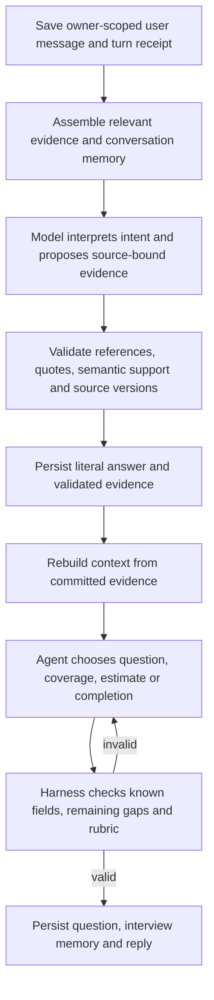

# Agent-led CV review harness

Uploaded-CV Skills Profile review uses an agent-led interview. The agent chooses
interview order, question wording, related fields to explore, and when to move on.
The backend owns durable memory, evidence publication and decision validation.
Manual-only Profile intake and confirmed-Career clarification retain their separate
existing paths. No extra database or agent framework is introduced.

## Turn lifecycle

Interpretation proposals are durably staged before execution. The existing answer
lifecycle saves literal answers before semantic verification and retains them after
failure. Normal factual interview turns reuse their already-admitted interpretation;
they do not run a second interpretation model merely to save it. Semantic verification
is a distinct admitted call. Planning starts only after the evidence actions succeed.
Corrections, removals and manual additions retain explicit confirmation. Confirmation
or action-specific recovery resumes the original interview planner once siblings finish.

The planner can choose any source; the harness hydrates a newly selected source
before permitting its question. Up to three planner calls per turn cover hydration,
answer recall and correction of invalid decisions. An invalid proposal never becomes
a fabricated fallback question. Errors retain the saved turn for explicit retry.
Model-capacity denial during interpretation/planning pauses the interview; a denial
inside evidence interpretation retains the existing failed-action recovery path.

## Responsibilities in code

| File | Responsibility |
|---|---|
| `conversation/interview.py` | Coordinate interpretation, staged actions, evidence commit, planning, question publication, pause and replay recovery. |
| `conversation/interview_memory.py` | Rebuild the current evidence ledger, persist navigation state, invalidate stale coverage/estimates, assemble bounded model context and retrieve older source answers. |
| `conversation/interview_policy.py` | Reject repeated/known targets, unsupported completion, unvisited experience dismissal and skill estimates that do not satisfy the evidence rubric. |
| `schemas/interview_evidence.py` | Shared fields, field statuses, attribution and quoted-source contract used by extraction and clarification. |
| `schemas/interview.py` | Typed model outputs for interpreting a turn and choosing the next interview action. |
| `clients/conversation.py` | Provider requests and separate interpretation/planning instructions. It never writes domain records. |
| `domain/capabilities.py` | Validate source anchors and semantic support, project current evidence and advance effective evidence identity when facts change. |
| `clarification/service.py` | Save literal answers, reserve result capacity, validate interpretations and publish with source/revision/lease fencing. |
| `conversation/service.py` | Existing authentication, message persistence, CAS, leases, independent action receipts and dispatch into the new harness. |

## Persistent memory and transient context

MongoDB remains the production persistence authority:

- `cvs`: original extraction, clarification answers, current effective evidence and
  retained histories. The common `review_evidence` fields cover role,
  responsibilities, personal contribution, assistance, task scope, complexity,
  problem solving, outcomes, skill use, recency, frequency and limitations.
- `cv_conversations.interview_memory`: source/evidence identities, focus, coverage,
  field attempt counts, bounded question history, exact user preference quotes,
  derived skill estimates and a rebuildable coverage summary. It survives reload,
  process restart and conversation segment rollover.
- `cv_conversations.messages`: the durable transcript and retry receipts. Internal
  proposals, memory and execution controls are not returned as public chat fields.

Each provider call gets a transient context capped at 96 KiB: all source identities
and field statuses, the focused source and its validated evidence, ten recent
messages, relevant saved source answers, preferences and interview progress.
Large answer histories become an ID index; the planner can request up to four
exact saved answers via `recall`. No factual answer is silently truncated. If the
focused context still cannot fit, processing fails with saved evidence retained.
The complete original transcript remains paginated; the harness does not send every
old conversational aside on every model request. Durable preference notes and
source-answer retrieval preserve relevant context without an unbounded prompt.

The summary contains coverage references, not model-written new facts. Current
validated evidence is authoritative. Effective evidence changes invalidate affected
coverage and skill estimates. Source-generation or explicit source correction
changes also reset corresponding attempt/decline state. Old records use additive
empty defaults; there is no destructive migration or automatic re-extraction.

## Evidence and interview decisions

Every field has a supported, partial, unknown, conflicting, skipped or not-applicable
status. A field being asked is not equivalent to its being resolved. Every proposed
fact quotes an exact source passage or current answer. Semantic verification checks
the interpretation, subject, negation and attribution, not only quotation presence.
Changed supported values additionally require consistency/refinement or an explicit
correction; otherwise retain conflicting evidence or ask a clarification.

The agent can fill several fields from one answer. Known fields are excluded from
new questions. Partial/conflicting fields remain open for distinct material follow-ups.
An explicit unknown or skip closes only that target, never the entire experience.
`CV_INTERVIEW_MAX_TARGET_ATTEMPTS` (default 2, allowed 1–5) limits repeated probing
without new information for a source/field/skill target. It is injected only into CV.
All calls retain the existing CV account/global admission and provider time bounds.

For `reviewed` coverage, the planner must cite supported personal/shared ownership
and concrete task/responsibility evidence. `reviewed_with_gaps` or deferred coverage
requires an actual answered/skipped discussion. Unvisited work/projects prevent
agent-declared completion. A user stop is always allowed and produces `paused`,
without asserting completeness or writing the explicit CV review stamp. The summary's
version-bound Save CV profile remains a separate acknowledgement.

Optional skill estimates are source-specific, derived and invalidated by evidence
changes. Supported levels are guided application, independent application and complex
application; insufficient evidence is explicit. Typed personal attribution and cited
ownership, assistance and skill-use evidence are required. Independence requires
explicit independent work; complex application additionally requires complexity and
problem-solving evidence. Team-only/observed work does not establish personal ability.
These estimates are not universal scores, practical assessments or independently
verified proficiency, and do not start an Assessment/Roadmap workflow.

## Verification and limits

`tests/test_cv_interview.py` covers both repository adapters with synthetic model
responses: durable resume, rich/partial answers, scoped skips, side questions, stopping,
semantic failures, repeated-question rejection, plan repair/retry, old answer retrieval,
late source changes, completion and skill-estimate guards. Provider adapter tests
exercise the real JSON request/response boundary. Frontend tests cover paused resume,
new evidence validation and display. See `tests/README.md` for disposable Mongo setup.

These tests establish harness behavior, not interview quality across real CVs. Prompt
wording, semantic judgments and skill calibration still need representative labelled
conversations and live-provider evaluation. The harness validates typed targets and
citations; it cannot prove that every natural-language question perfectly matches its
declared target or that a user's stated experience independently demonstrates mastery.
