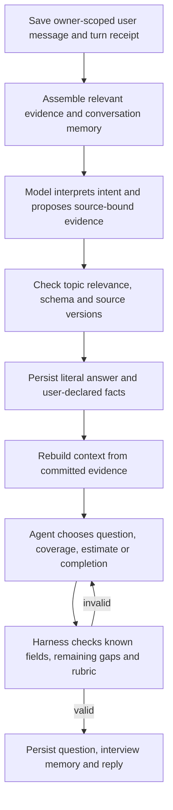

# Agent-led CV review harness

Uploaded-CV Skills Profile review uses an agent-led interview. The agent chooses
interview order, question wording, related fields to explore, and when to move on.
The backend owns durable memory, statement publication and decision validation.
Review information is self-reported: relevant user answers take precedence over
the CV and earlier statements, while originals and answer history remain saved.
Manual-only Profile intake and confirmed-Career clarification retain their separate
existing paths. No extra database or agent framework is introduced.

## Turn lifecycle

Interpretation proposals are durably staged before execution. The answer lifecycle saves literal answers before processing and retains them
after failure. Review validation checks schema, topic relevance and source identity;
it does not verify agreement with the CV, quote entailment or earlier answers. Normal factual interview turns reuse their already-admitted interpretation;
they do not run a second interpretation model merely to save it. Review turns do not make a separate evidence-verification call. Planning starts
after statement actions succeed. One automatic schema retry is allowed; repeated
malformed output asks a conversational clarification without a failed evidence card.
Corrections, removals and manual additions retain explicit confirmation. Confirmation
or action-specific recovery resumes the original interview planner once siblings finish.

The planner can choose any source; the harness hydrates a newly selected source
before permitting its question. Up to three invalid-decision attempts and three context-loading calls per turn
cover source hydration, answer recall and correction. Context retrieval does not
consume the invalid-decision allowance; total planner calls remain bounded at six. An invalid proposal never becomes
a fabricated fallback question. Errors retain the saved turn for explicit retry.
Model-capacity denial during interpretation/planning pauses the interview; a denial
inside evidence interpretation retains the existing failed-action recovery path.

## Responsibilities in code

| File | Responsibility |
|---|---|
| `conversation/interview.py` | Coordinate interpretation, staged actions, evidence commit, planning, question publication, pause and replay recovery. |
| `conversation/interview_memory.py` | Rebuild the current evidence ledger, persist navigation state, invalidate stale coverage/estimates, assemble bounded model context and retrieve older source answers. |
| `conversation/interview_policy.py` | Reject repeated/known targets, unsupported completion, unvisited experience dismissal and skill estimates that do not satisfy the evidence rubric. |
| `schemas/interview_evidence.py` | Shared fields, field statuses, attribution and quoted-source contract used by extraction and clarification. |
| `schemas/interview.py` | Typed model outputs for interpreting a turn and choosing the next interview action. |
| `clients/conversation.py` | Provider requests and separate interpretation/planning instructions. It never writes domain records. |
| `domain/capabilities.py` | Validate source anchors and semantic support, project current evidence and advance effective evidence identity when facts change. |
| `clarification/service.py` | Save literal answers, reserve result capacity, validate interpretations and publish with source/revision/lease fencing. |
| `conversation/service.py` | Existing authentication, message persistence, CAS, leases, independent action receipts and dispatch into the new harness. |

## Persistent memory and transient context

MongoDB remains the production persistence authority:

- `cvs`: original extraction, clarification answers, current effective evidence and
  retained histories. The common `review_evidence` fields include self-reported replication confidence and cover role,
  responsibilities, personal contribution, assistance, task scope, complexity,
  problem solving, outcomes, skill use, recency, frequency and limitations.
- `cv_conversations.interview_memory`: source/evidence identities, focus, coverage,
  field attempt counts, bounded question history, exact user preference quotes,
  derived skill estimates and a rebuildable coverage summary. It survives reload,
  process restart and conversation segment rollover.
- `cv_conversations.messages`: the durable transcript and retry receipts. Internal
  proposals, memory and execution controls are not returned as public chat fields.

Each provider call gets a transient context capped at 96 KiB: all source identities
and field statuses, the focused source and its validated evidence, four recent
messages (excluding processing placeholders), preferences and compact interview
progress. A deterministic discussion summary groups retained question history by
source, with answered/skipped counts and latest target references; full question
wording is not replayed. Attempt details are scoped to the focused source. These
projections rebuild from existing durable memory without a summarisation model call.
Saved source answers are always an ID/target/status index by default; the planner
can request up to four complete exact answers via `recall` when wording is needed.
Only the requested answers are hydrated on that call. No factual answer is silently
truncated. If the focused context still cannot fit, processing fails with saved
evidence retained.
The complete original transcript remains paginated; the harness does not send every
old conversational aside on every model request. Durable preference notes and
source-answer retrieval preserve relevant context without an unbounded prompt.

The summary contains coverage and discussion references, not model-written new
facts. Current validated evidence is authoritative. Effective evidence changes invalidate affected skill estimates. Topic coverage
records navigation: ordinary clarification answers preserve completed topics;
source-generation or explicit source correction changes reopen affected topics
and reset corresponding attempt/decline state. Old records use additive
empty defaults; there is no destructive migration or automatic re-extraction.

## Evidence and interview decisions

Review records use supported, partial, unknown, conflicting, skipped or
not-applicable statuses to represent the user's account, not independent proof.
The interpreter classifies topic relevance within the typed turn; short answers
inherit the active topic, corrections are relevant even when the CV disagrees,
and unrelated messages redirect without updating facts or advancing the review.
Schema/reference/capacity, authentication, ownership and stale-write checks remain.
Latest relevant review facts replace earlier facts at the same field/skill scope;
no comparison or consistency approval against CV evidence is required. Extraction
and legacy target-specific clarification retain their existing separate validation.

The agent can fill several fields from one answer. Known fields are excluded from
new questions. Partial/conflicting fields remain open for distinct material follow-ups.
An explicit unknown or skip closes only that target, never the entire experience.
`CV_INTERVIEW_MAX_TARGET_ATTEMPTS` (default 2, allowed 1–5) limits repeated probing
without new information for a source/field/skill target. It is injected only into CV.
All calls retain the existing CV account/global admission and provider time bounds.

For `reviewed` coverage, the planner must cite supported personal/shared ownership
and concrete task/responsibility evidence. An unproven `reviewed` label does not
reject the planner's next step: the harness saves `reviewed_with_gaps` with no
citations and logs a content-free reason. Unusable citations are dropped. Coverage
already saved for a topic, and coverage for sources outside the review topics, is
ignored. `reviewed_with_gaps` or deferred coverage
requires an actual answered/skipped discussion. Unvisited work/projects prevent
agent-declared completion. A user stop is always allowed and produces `paused`,
without asserting completeness or writing the explicit CV review stamp. The summary's
version-bound Save CV profile remains a separate acknowledgement.

Optional skill estimates are source-specific, derived and invalidated by evidence
changes. Supported levels are guided application, independent application and complex
application; insufficient evidence is explicit. Typed personal attribution and cited
ownership, assistance and skill-use evidence are required. Independence requires
explicit independent work; complex application additionally requires complexity and
problem-solving evidence. Team-only/observed work does not establish personal ability.
These estimates are not universal scores, practical assessments or independently
verified proficiency, and do not start an Assessment/Roadmap workflow.

## Verification and limits

`tests/test_cv_interview.py` covers both repository adapters with synthetic model
responses: durable resume, rich/partial answers, scoped skips, side questions, stopping,
schema recovery, topic rejection, repeated-question rejection, plan repair/retry, old answer retrieval,
late source changes, completion and skill-estimate guards. Provider adapter tests
exercise the real JSON request/response boundary. Frontend tests cover paused resume,
new evidence validation and display. See `tests/README.md` for disposable Mongo setup.

These tests establish harness behavior, not interview quality across real CVs. Prompt
wording, semantic judgments and skill calibration still need representative labelled
conversations and live-provider evaluation. The harness validates typed targets and
citations; it cannot prove that every natural-language question perfectly matches its
declared target or that a user's stated experience independently demonstrates mastery.

## Conversation progress and completion

`InterviewProgress.topics` exposes stable source IDs, titles and pending/current/
reviewed/reviewed-with-gaps/deferred states. `interview_memory.topic_ids` retains
one topic per experience/project needing clarification, across follow-ups, reloads
and segment rollover. Counts refer to topics, never question count or proficiency.
Source additions/removals may change the topic set; a reviewed topic does not vanish
just because its clarification filled the original gaps. Manual intake reports its
four background areas as topics through the same progress response.

The chat starts/resumes questions automatically on opening; completed reviews do
not restart. Ordinary clarification receipts are hidden, and genuine processing
failures use compact recovery. An old evidence-alignment failure gets one automatic
retry per open chat mount under the review policy. Explicit corrections/removals
retain confirmation controls. After all review topics are covered, the server
announces completion and the UI shows **Review profile**, opening the Skills Profile
summary (`/cv`). There is no routine Continue review or persistent summary button.
Early stopping remains paused, not complete; uncertainty can remain at completion.

Answer recovery publishes the pending planner continuation atomically with the saved
action, so polling cannot stop in a gap before the next question is scheduled.

Topic completion is committed with a validated move to another source, or with
review completion. Follow-ups keep their current topic open even if the planner
proposes coverage for it. Moving on after a discussion without an explicit
coverage judgment records reviewed-with-gaps; it does not assert complete facts.
Pauses and side questions do not complete topics. Transition context includes the
previous and next source evidence so closing judgments can cite the correct source.

## Planner rejection diagnostics

Planner proposals use exact `question_options` derived from the same admission
policy as validation, including configured attempt limits. Explicit unknown, skipped
and not-applicable answers are closed targets; a missing field is distinct.
The planner chooses ask/finish/pause/recall; ordinary answer processing stays in
the interpreter. Provider-adapter schema failures receive bounded schema correction
within the same invalid-decision allowance, without repeating saved interpretations.

Each rejected or context-loading step records an allowlisted reason/action in the
parent receipt’s private `_interview_planning` list (at most six events per attempt),
with a content-free log event. No reply, question, skill name, CV text, raw provider
output or schema input is logged. Exhaustion returns a fixed explanation of its last
rejection category. Earlier failures without diagnostics cannot be reconstructed
from the generic saved error. Prompt provenance is `cv-interview-11`.

Internal IDs remain in structured backend fields. Prompts prohibit IDs in visible
replies/estimate explanations; the frontend also filters opaque source references
from assistant display, including saved replies. Literal user messages and saved
transcripts are preserved.

## Three-question topic budget

Each uploaded-CV topic has a hard maximum of three issued questions, including its
opening question and skipped questions. Potential clarification areas are scope/objective, responsibilities personally
handled and confidence in repeating a similar task. These are not mandatory
questions: the CV supplies known context, and optional missing details alone
do not justify probing. Known answers allow
earlier completion and adaptation; the agent asks one clear question per turn.
`replication_confidence` is an explicit self-report field, not evidence of mastery
or independent ability. Ordinary factual answers still reuse the existing validated
interpretation and do not require another provider verification call.

Memory `question_counts` and `discussed_topic_ids` rebuild from all retained CV
interview questions, not the last 120 memory entries. The budget survives reloads,
retries, source corrections and conversation rollover for the same source identity.
Failed planner proposals and side-question explanations do not consume slots.
The planner receives each source’s asked/remaining count and an exact focused
budget; the validator rejects a fourth question regardless of its target field.
At the limit, a discussed topic can finish with gaps, while unvisited topics still
prevent completion. Existing topics already beyond the limit get no further
generated questions after the current answer/skip.

Before publication and API delivery, assistant prose and active questions strip
internal fact/source/evidence references, including `fact:` and `answer:` IDs.
Read projections clean legacy assistant replies/estimate explanations without
rewriting saved history or literal user messages. Structured evidence references
remain available to the backend, and the frontend also filters older replies.

## Clarification-first routing

Extraction validates the CV, then the LangGraph `prepare_review` node removes
review flags already resolved by its source-grounded facts. Legacy target-specific
uncertainties remain independent. `domain/review_context.py` also projects current
effective evidence for existing CVs without re-extraction or additional inference.

Review uses full focused CV descriptions/excerpts/skills and the supported fact
ledger. It selects experiences only for material ambiguous claims, responsibility
uncertainties, partial/conflicting facts or unclear personal/team boundaries.
`clarification_targets` and scoped `clarification_fields` guide specific questions;
missing optional proficiency/confidence/duration does not require an interview.
The planner acknowledges known CV context and asks for the missing distinction,
without requesting a skill inventory or a repeated description of clear work.

Zero questions can suffice when source evidence already supports the skill baseline;
one rich clarification can complete a project. Otherwise clear CV wording alone
does not end baseline review: missing personal skill application/support remains
a reason for targeted questions, within the project’s own three-question budget. It preserves discussed-topic progress and the three-question maximum.
Sources with a complete supported baseline need no repeated questions. Old unvisited optional-only
topics and obsolete active prompts retire through conversation reconciliation.
Extraction prompt provenance is `cv-extraction-11`; graph provenance is
`cv-extraction-6`. Distinct review facts may share a field and normalized skill
name. Each retains its value, attribution and source quotations; only identical
facts are deduplicated. Review readers keep the whole group, including unresolved
or conflicting facts. Unknown attribution does not assert ownership. A new
workflow version starts a fresh extraction rather than reusing an older saved
candidate. No extra model call is added.

Review quotations must match their cited original block, allowing case, whitespace
and Unicode presentation differences. Extraction checks these anchors before
semantic verification and gives indexed repair guidance for a missing source ID
or a nonmatching quotation. Semantic approval applies to factual interpretations
and ordinary source summaries; it cannot approve a paraphrase as a review quote.
The existing single-repair limit and final quotation guard remain in place.

## Baseline skill review per project

One topic is one whole project or experience, not the entire review and not a
separate three-question budget for each skill. Every project has its own maximum
of three issued questions; there is no additional cap on the number of topics.
Existing upload/history/context capacity limits remain separate. A five-project
CV can therefore have up to fifteen questions. Known CV content and related
skills are grouped in specific responsibility/application questions, without
asking for the skill inventory again.

The planner seeks personal responsibilities, concrete application/depth of all
project skills, and assistance/independence, outcomes and limitations. Skill gaps
remain reviewable even when the project description is clear. One answer may
cover several skills; completion can be earlier than three questions if the
baseline is established. At exhaustion, move to the next project, not to whole-
review completion while other unvisited projects remain.

`domain/baseline.py` projects every project skill to guided_application,
independent_application, complex_application or insufficient_evidence from
current CV/review evidence. Personal application, assistance and concrete skill
use are required for a supported level; confidence and duration do not establish
independence. Team/observed/denied work and conflicting evidence cannot establish
a personal level. The full projection stays in backend memory/planner context. Public
`CvDetail.skill_estimates` and conversation responses include only supported
estimates, which are shown in the saved project summary. It is
derived from CV-owned facts, not a new skill authority or Assessment result.
Source corrections recompute the read projection; immutable saved CV/user
evidence and separate Assessment/Roadmap workflows retain their boundaries.

Baseline levels use one shared deterministic projection for CV detail and chat;
optional planner grade proposals do not override that user-facing projection.
Complex application additionally requires skill-specific complexity/problem-solving
evidence, so general project difficulty does not inflate every skill. Reply
publication normalizes memory before saving, making unchanged status polling
revision-stable and avoiding private-only revision conflicts on the next answer.

## Relevant gaps and private insufficient-evidence diagnostics

Insufficient-evidence entries remain in the shared backend baseline projection,
private conversation memory/progress and planner context. Public CV detail and
conversation projections omit those entries; frontend summary/chat also filter
legacy responses and render no empty estimate section. Supported estimates remain
visible. Source facts and literal user messages are retained.

The three-question budget per whole project/experience targets relevant evidence
gaps, not every absent rubric field. Responsibility/ownership is established once
at project scope, and concrete use of the named project skills is prioritized.
Assistance/independence is offered as a follow-up after a relevant application is
known. Peripheral partial/missing recency, frequency, confidence, role labels,
outcomes and limitations do not by themselves generate required review targets.
Planner open_fields are the currently relevant clarification fields, not the full
set of validator-admissible missing values. The planner must not print internal
diagnostic labels or a missing-field checklist to the user.

## Skips, uncertain ownership and recovery

A question skip is accepted from the Skip control, a whole-message refusal such as
"skip this" or "I don't want to answer that" (matched without a model call), or a
refusal the interpreter classifies as `skip`. The interview then moves on: a
distinct remaining question on the topic, or the next topic. A topic with nothing
left to ask closes as `reviewed_with_gaps`, and so does the skipped topic if the
planner then fails to choose a valid step, followed by one more planning attempt.

A question skip is durable in the existing CV clarification receipt. Its exact
field/skill targets project as private `_review_skips` dispositions with status
`reviewed_with_gaps`; no factual answer, evidence quote, skill claim or competence level
is fabricated. The skipped ownership target is closed to repeat questioning,
including a later skill-specific rephrase of a generic ownership skip. Other
useful questions can continue within the existing three-question project budget.
Source corrections/reconciliation and extraction generations fence old skips.

Explicit skipped/unknown/not-applicable ownership can close as reviewed-with-gaps.
If the planner instead proposes `reviewed`, the harness conservatively normalizes
that coverage to reviewed-with-gaps without inventing ownership citations. Missing
ownership without an explicit disposition is normalized the same way and still
cannot pass as verified. Other
unvisited projects and skill-level evidence guards remain enforced.

After a failed next-step decision with no active question, **Skip and continue**
lets the owner defer remaining questions for the current known project. The private
`deferred_topics` record labels remaining ownership uncertain. Saved answers,
interpretations, source facts and supported estimates remain intact. Related failed
planning receipts are cancelled/fenced so retry cannot revive the abandoned step;
unrelated interpretation/correction failures are not bypassed. The next uncovered
project is planned, or the review finishes with gaps if none remain. Deferral is
saved before planning and source-version/fingerprint checked on retries; it survives
reload/segment rollover and invalidates when the source changes.
